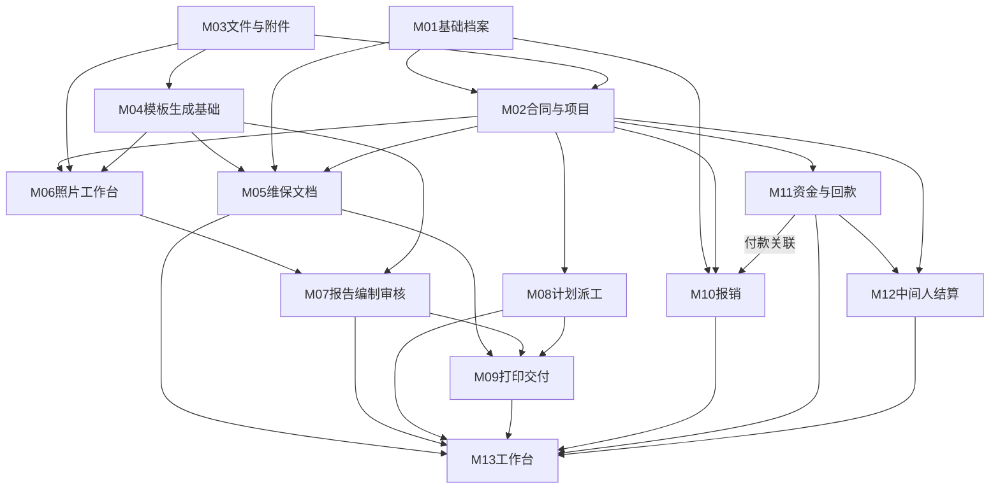

# 业务模块拆分与实施清单

配套总体方案：[SYSTEM_DESIGN.md](SYSTEM_DESIGN.md)。本文件用于后续按模块开发、验收和追踪进度。模块中的表名、接口和目录是建议设计，开发时结合现有结构确定。

## 1. 拆分结论

建议划分 **13 个逻辑业务模块**。这些模块先在现有 Spring Boot 应用和 Vue 前端内实现，复用同一 MySQL；不要求建立 13 个微服务或 13 个 Maven 工程。

| 编号 | 模块 | 核心交付 | 当前基础 |
| --- | --- | --- | --- |
| M01 | 基础档案 | 客户、场所、工程师、中间人资料 | 已有账号、人员/代理人等部分资料，需核对补齐 |
| M02 | 合同与履约项目 | 合同、项目关联、负责人及变更 | 已有合同 CRUD；履约项目关系待补 |
| M03 | 文件与附件 | 统一存储、附件引用、权限和可用状态 | 统一文件服务已实现，继续完善 |
| M04 | 模板与文档生成基础 | 模板版本、字段/图片槽位、生成任务 | 已有维保卡 PDF 填充，通用能力待补 |
| M05 | 维保文档 | 负责人变更说明、维保卡 PDF | 已有维保卡部分能力 |
| M06 | 照片导入与标记工作台 | 本地批量导入、Web 标记、归位和排序 | 待开发 |
| M07 | 报告编制与审核 | 按标记生成报告、版本、审核、签发 | 已有报告 CRUD 和文件归档 |
| M08 | 工作计划与派工 | 月度维保、专项任务、人员排程 | 已有 Quartz 基础，业务计划待补 |
| M09 | 打印与寄送交付 | 文档版本、打印份数、物流、补寄 | 已有部分打印/邮寄标记 |
| M10 | 出差报销 | 费用明细、审核、项目分摊、付款关联 | 待开发 |
| M11 | 资金流水与客户回款 | 收付款流水、客户应收、回款核销 | 待开发 |
| M12 | 中间人结算 | 合同额报酬规则、分期结算、支付 | 已有中间人档案，无完整结算流程 |
| M13 | 工作台、通知与统计 | 角色待办、超期提醒、项目进度与经营统计 | 已有首页基础，需统一业务数据 |

“已有基础”不表示该模块已全部完成。后续以各模块的验收标准判定完成。

## 2. 已确认的业务边界

1. 项目分公司自营和中间人项目，甲方先付款给公司，公司再与中间人结算。
2. 中间人项目中，公司报酬总额按合同额乘约定比例确定，并分期结算。具体分期分摊节奏仍需确认，不能当作已经确定的规则写死。
3. 负责人变更说明读取系统中的项目和工程师资料，按模板生成。
4. 维保卡由用户填写或确认信息，直接输出可打印 PDF。
5. 检测、评定、评估的照片由文员批量从本地选择，在 WebUI 中标记，后台据此生成报告。
6. 工程师继续使用现有手机和拍照工具；照片工作流不要求新 App 或专门的现场手机网页。
7. 外部维保软件继续使用；一期手工导出报告并归档，取得明确接口授权后再考虑自动同步。

## 3. 各模块的功能与验收

### M01 基础档案

**职责**：维护可复用的资料，为项目、变更说明、报告和结算提供准确来源。

**功能范围**：

- 客户档案、联系人、联系地址和常用收件信息。
- 场所档案：项目实际地址、名称、所属客户及涉及的消防系统。
- 工程师档案：姓名、联系方式、岗位，以及实际模板需要的资格/人员资料和附件。
- 中间人档案：名称、联系方式、结算主体、结算账户等；账户修改单独授权和留痕。
- 状态与历史：在职/离职、启用/停用、资料版本和变更记录。

**数据归属**：`customer`、`site`、`engineer_profile` 等；复用并扩展现有 `biz_agent`。登录账号可以关联工程师档案，但登录账号本身不等于完整工程师资料。

**依赖与边界**：复用现有用户、角色、文件服务。M01 管主档，正式文档和支付单据中的历史快照由对应业务模块保存。

**首版交付**：先补齐负责人变更说明实际使用的工程师和项目关联资料，不强制先做完整人事管理。

**验收标准**：

- [ ] 同一工程师和场所可以被多个项目引用，无须重复录入。
- [ ] 主档更新不会改变已经生成的历史说明或报告。
- [ ] 停用档案仍能查看历史引用，不能被随意删除造成断链。
- [ ] 银行账户等敏感字段按角色控制访问。

### M02 合同与履约项目

**职责**：建立业务主线，明确合同、场所、人员和资金规则的归属。

**功能范围**：

- 扩展现有合同，保存服务类型、金额、期限、签约主体、项目归属和收款约定。
- 建立履约项目，关联合同、客户、场所和服务期间。
- 分开记录中间人、项目执行负责人、签约主体和实际收款主体。
- 项目成员与负责人历史：新旧负责人、生效日期、变更原因、确认人。
- 合同和项目变更，保存版本及影响范围；历史已完成事项保留原快照。
- 项目详情作为各模块入口，分别展示资料、文档、任务、交付、费用、回款和结算。

**数据归属**：扩展 `zj_contract`；新增 `service_project`、`project_member`、`project_responsible_change`、`contract_revision` 等。现有 `zjerp_project_system` 用于消防系统选择，不直接替代履约项目。

**依赖与边界**：依赖 M01、M03。M02 保存合同金额和结算规则的商务版本，M11 保存实际流水和核销，M12 保存结算单及计算快照。金额改为 DECIMAL / BigDecimal，历史数值转换需核对。

**首版交付**：先完成最小项目档案、负责人和合同关联，供 M05、M06 使用；合同变更影响分析和完整项目工作台可以后续补齐。

**验收标准**：

- [ ] 一份合同可关联多个履约项目，合同额不会在项目汇总中重复计算。
- [ ] 可分辨公司项目和中间人项目，以及各自的负责人。
- [ ] 预览变更说明不会立即修改项目负责人，确认后才记录变更。
- [ ] 未来生效的人员变更与历史负责人可分别查询。

### M03 文件与附件

**职责**：统一处理文件的存储、引用、访问和生命周期。

**功能范围**：

- 复用现有上传服务，保留原文件名、标准存储键、哈希、大小和类型等元数据。
- 支持内部生成文件登记，使 PDF、Word 和缩略图也走统一文件服务。
- 增加业务附件引用，保存对象、用途、顺序和引用版本；支持一个文件被多处引用。
- 附件权限沿项目、报告、报销或结算对象检查，提供内部鉴权下载。
- 区分待核验、可用和缺失等状态；历史仅迁移元数据的记录不被当作原文件齐全。
- 保留原图，缩略图和报告用派生图另存；上传失败、回滚和未引用文件清理可追踪。

**数据归属**：现有 `sys_file`；新增 `business_attachment`，必要时增加派生文件关系。现有 `biz_type/biz_id` 通过兼容读取逐步迁移，无须重新移动所有文件。

**依赖与边界**：使用已有身份认证和权限接口，不依赖某个具体业务模块的 Mapper。业务模块提供对象访问判定，M03 负责执行存储和访问控制。

**首版交付**：优先增加生成文件保存入口及附件引用，服务 M04、M05、M06；复用已经完成的统一上传改造。

**验收标准**：

- [ ] 原文件名、项目名称均不直接决定物理路径。
- [ ] 解除一处引用不会破坏其他业务中的文件。
- [ ] 未授权用户不能通过猜测文件 ID 下载业务附件。
- [ ] 不存在原件的旧记录有明确提示，不伪造哈希或大小。

### M04 模板与文档生成基础

**职责**：提供共用的模板和生成能力，供维保文档及报告模块调用。

**功能范围**：

- 管理负责人变更说明、维保卡、检测/评定/评估报告模板。
- 模板草稿、发布、停用及不可变版本；保存纸张、方向、字体和适用文档类型。
- 定义文字字段及图片槽位；槽位保存稳定编码、数量、尺寸、题注、重复分组等规则。
- 统一生成请求：模板版本、输入资料快照、图片位置绑定、输出格式。
- 持久化生成任务，保存状态、失败原因、重试和生成结果；限制并发。
- 复用现有 PDF 表单填充；分步补齐 Word 文字、图片、重复表格装配。

**数据归属**：`document_template`、`template_version`、`template_field`、`template_image_slot`、`generation_job`、`generated_document` 等。

**依赖与边界**：依赖 M03。引擎接收调用方准备好的输入快照，不自行查询合同、工程师、照片标记或报告审核表；业务规则由调用模块负责。

**分步交付**：

- M04-A：模板版本、生成任务、现有 PDF 填充封装。
- M04-B：变更说明所需的文字模板生成。
- M04-C：报告所需的图片槽位、排序、重复区块和 Word 装配。

**验收标准**：

- [ ] 同一模板版本及输入快照可重复生成内容一致的文档。
- [ ] 发布新模板不会改变历史文件及历史任务输入。
- [ ] 必填字段缺失、图片不可用和布局异常有明确反馈。
- [ ] 任务失败可重试，重复请求不会产生多个正式业务版本。
- [ ] 用实际模板验证长文字、中文字体、图片方向和跨页表格。

### M05 维保文档

**职责**：完成用户直接需要的负责人变更说明和维保卡 PDF。

**功能范围**：

- 负责人变更说明：选择项目和新负责人，带入新旧工程师资料，填写原因、生效日期，预览和确认。
- 确认时调用 M02 保存变更，使用确定的项目/人员快照创建文档任务。
- 维保卡：用户填写或确认项目名称、单位、负责人、电话、系统、服务时间和编号。
- 直接生成 PDF，支持预览、下载、浏览器打印和重新生成。
- 保存每次生成的输入、模板版本、确认状态和文件；文档生成失败可重试。
- 生成记录可交给 M09 建立打印、寄送记录。

**数据归属**：`maintenance_document`、`maintenance_document_revision`、`maintenance_card_input` 等；负责人变更事实归 M02，模板及任务归 M04。

**依赖与边界**：维保卡独立手工填写首版只需要 M03、M04；自动带入资料和变更说明需要 M01、M02。M05 不维护工程师主档，也不把浏览器打开打印窗口等同于实际打印完成。

**首版交付**：先交付手工填写维保卡 → PDF；随后交付资料带入、负责人变更说明和文档版本。

**验收标准**：

- [ ] 用户填表后能得到符合实际模板尺寸的 PDF，长内容不会静默截断。
- [ ] 选择项目和工程师后能自动填充变更说明。
- [ ] 试填、预览和确认变更的效果清楚区分。
- [ ] 重新生成保留旧文件，人员主档变化不影响历史文档。

### M06 照片导入与标记工作台

**职责**：把文员收到的本地照片整理成后端可以准确装配的图片清单。

**功能范围**：

- 选择项目和报告模板版本，建立照片整理集并批量选择本地照片上传。
- 导入批次、上传进度、失败重试、原图和缩略图、未上传完成提示。
- 左侧模板分类/槽位树、中间缩略图、右侧大图与标记信息。
- 多选、批量标记、拖拽归位、排序、说明、撤销，以及未标记/已标记/排除筛选。
- 标记内容按模板需要提供系统、检查项、用途、位置/对象分组；公共信息可批量继承。
- 一次归位同时保存标记和位置绑定；有歧义时由文员确认，不重复填写两套信息。
- 输出选用照片、槽位、对象分组、顺序及说明的不可变快照，供 M07 生成报告。

**数据归属**：`photo_import_batch`、`photo_collection`、`project_photo`、`photo_mark`、`photo_slot_binding` 等。

**依赖与边界**：依赖 M02 最小项目档案、M03 文件、M04 模板槽位。整理集自己有 ID，不要求先有完整报告模块；M07 后续引用整理集。M06 保存当前编辑结果，报告正式版本保存的图片快照归 M07。

**首版交付**：用一份实际模板和一批照片，实现批量导入、最少必要标记、位置绑定及顺序保存。工程师沿用现有拍照方式，不建设采集 App。

**验收标准**：

- [ ] 批量操作能处理一组照片，不要求每张重复填写项目资料。
- [ ] 上传失败、待保存和已保存状态清楚，原图及已有水印保持完整。
- [ ] 同类多楼层/设备的图片不会混放，单图槽位冲突能够提示。
- [ ] 刷新后能恢复已保存的整理结果，重复导入不静默丢图。
- [ ] 多文员编辑有版本冲突提示，大量照片按需加载缩略图。

### M07 报告编制与审核

**职责**：将照片标记及工程师提供的数据变成可审核、可签发的报告。

**功能范围**：

- 扩展现有报告，关联项目、服务类型、模板版本及照片整理集。
- 文员录入文字、技术数据和单位，检查模板必需项、缺图和位置冲突。
- 固定资料与图片快照，调用 M04 按绑定位置生成 Word。
- 下载检查实际生成结果，保存草稿和重新生成版本。
- 工程师提交审核、退回意见、修改及重新送审；正式通过后签发锁定版本。
- 手工 Word 修改后以新版本回传，明确与系统结构化数据的关系。
- 向 M09 提供可交付的正式报告版本及文件。

**数据归属**：扩展 `zj_report`；新增 `report_version`、`report_input_snapshot`、`report_review_action` 等。检查项和技术数据也由 M07 管理，M06 只负责照片整理。

**依赖与边界**：依赖 M02、M03、M04、M06。首版可只挂项目，M08 完成后再关联具体工作任务。M07 拥有送审、通过、签发的业务权限；M04 生成成功不代表审核通过。

**首版交付**：只选一类真实报告，完成照片整理集 → Word 草稿 → 人工审核；先验证实际文件，再扩展其余模板和在线预览。

**验收标准**：

- [ ] 图片按位置、对象分组和顺序插入，字体、表格及题注可用。
- [ ] 技术数据来自人工录入/确认，不默认从照片推断结论。
- [ ] 标记修改不会改变正在生成或已经签发版本的输入。
- [ ] 退回可定位问题，修改后重新送审，历史意见保留。
- [ ] 签发版本不可被新模板、项目资料或手工覆盖静默改变。

### M08 工作计划与派工

**职责**：安排工作，跟踪每月维保及检测、评定、评估任务的履约情况。

**功能范围**：

- 从合同/项目建立周期计划和专项任务，配置日期、责任人和完成条件。
- 每个维保项目每个周期建立一条履约义务，复访是子任务。
- 工程师排程、参与人、请假/出差与时间冲突检查、延期及重新分配。
- 外部维保报告的月份、来源标识、本地文件和办公室核对状态。
- 到场、报告归档和交付分别跟踪；合同到期后保留未完成的历史义务。
- Quartz 扫描持久化计划，重启后补扫，唯一键避免重复生成。

**数据归属**：`service_plan`、`service_period`、`work_order`、`work_assignment`、`maintenance_report_import` 等。

**依赖与边界**：依赖 M01、M02、M03，复用现有 Quartz。M08 维护外部维保报告的履约归档记录，M07 维护内部编制报告的版本与审核；两者不互相替代。人员变更历史由 M02 保存，M08 处理受影响的未来排程。

**首版交付**：先做维保月度义务及办公室待办，再增加专项任务和人员冲突检查。

**验收标准**：

- [ ] 同一项目同周期不重复生成义务，重启后不会漏掉待生成周期。
- [ ] 同时排程时在后端重新校验冲突，不能只靠前端提示。
- [ ] 能区分已到场、未归档报告、未寄送等状态。
- [ ] 延期、换人及外部报告导入保留操作者和原因。

### M09 打印与寄送交付

**职责**：记录具体哪份文档、哪个版本，以多少份、向谁交付。

**功能范围**：

- 从负责人变更说明、维保卡、正式报告和月度维保报告建立交付清单。
- 文档版本、打印份数、打印确认、收件信息和地址快照。
- 邮寄批次、物流单号、寄送人、日期、签收或异常。
- 多份文档合并寄送，同时保留每份文档的项目归属。
- 退回、补寄和重新打印作为新记录，保留原交付过程。

**数据归属**：`delivery_order`、`delivery_item`、`print_record`、`delivery_event` 等。

**依赖与边界**：依赖 M03；按使用场景接入 M05、M07、M08 提供的已确认文档。M09 不修改源文件，也不自行把草稿报告变成正式版。报告交付使用 M07 签发版本，月报使用 M08 已核对归档记录。

**首版交付**：先支持维保卡/说明打印登记和手工填写物流单号，不以接入快递平台为前提。

**验收标准**：

- [ ] 可查到每次打印、寄送所用版本和份数。
- [ ] 修改客户地址不会修改历史寄送信息。
- [ ] 补寄、退回不会覆盖原物流记录。
- [ ] 合并寄送后仍能按项目查询欠交的文档。

### M10 出差报销

**职责**：管理员工为项目发生的费用、审批、分摊和报销支付。

**功能范围**：

- 关联出差、项目、员工和日期，录入费用类别、金额、用途及票据。
- 保存草稿、批量明细、提交、退回和修改历史。
- 业务确认、财务审核及待支付状态；节点可根据公司实际简化。
- 多项目费用分摊，检查分摊合计等于费用金额。
- 对接 M11 实际付款流水，支持部分付款、撤销和调整。
- 重复票据提示；OCR 预填作为后续增强，不影响首版上线。

**数据归属**：`trip`、`expense_claim`、`expense_line`、`expense_project_allocation`、`expense_payment` 等。

**依赖与边界**：报销登记及审核依赖 M01、M02、M03；付款确认依赖 M11。M10 判断报销单是否可支付及未付余额，M11 管实际资金流水和可分配余额。项目报销不会自动成为中间人扣款。

**首版交付**：先做费用登记、票据、审核和待支付列表，资金流水模块完成后接入付款核销。

**验收标准**：

- [ ] 费用可追到员工和项目，跨项目分摊金额相符。
- [ ] 审核通过与实际已付款明确区分。
- [ ] 部分付款和重复操作不会超付。
- [ ] 员工只能查看本人或被明确授权的报销资料。

### M11 资金流水与客户回款

**职责**：保存实际资金进出事实，管理客户付款计划与回款核销，并为 M10/M12 提供付款关联能力。

**功能范围**：

- 收付款账户及流水：方向、日期、金额、对方主体、银行参考号、凭据及确认状态。
- 合同付款计划：固定日期或合同约定事件触发的应收节点。
- 收款认领与核销，支持一笔款分配多份合同、一个节点由多笔款支付。
- 未认领款、部分回款、逾期、退款、冲销和调整。
- 对外提供付款流水分配及余额校验，供报销和中间人结算调用。
- 资金统计区分实际收支、已核销金额及未分配余额。

**数据归属**：`fund_account`、`fund_transaction`、`fund_transaction_allocation`、`receivable_plan`、`receipt_allocation`、`fund_adjustment` 等。实际流水事实集中在此，M10/M12 保存各自业务付款关系。

**依赖与边界**：依赖 M01、M02、M03。M11 不计算中间人报酬、不审批报销。由调用模块检查目标单据的可付余额，M11 检查流水方向、状态和可分配余额；组合动作在同一应用服务事务中完成，不直接跨模块改表。

**首版交付**：先支持人工登记客户回款和合同核销，再增加银行流水导入、付款关联和自动匹配建议。

**验收标准**：

- [ ] 收款流水与应收节点明确分开，未分配金额可查询。
- [ ] 核销不超过流水和相应应收的可用余额。
- [ ] 同一付款流水不会被报销和结算重复占用到超过流水金额。
- [ ] 并发、重复提交和退款调整有可追踪且金额正确的结果。
- [ ] 金额使用 DECIMAL / BigDecimal，不能以手改状态代替流水。

### M12 中间人结算

**职责**：依照合同规则，从已确认的客户回款中计算、确认并支付中间人分期款项。

**功能范围**：

- 读取合同额、公司比例和规则版本，确定公司应得总额及中间人基础总额。
- 关联 M11 已核销到合同的回款，按确认的分期分摊规则生成结算草稿。
- 保存每次计算采用的合同/比例/回款明细快照。
- 结算确认、审批占用、待支付、部分支付和已支付。
- 关联 M11 付款流水，保存中间人收款账户快照。
- 已确认的代垫、扣款、退款和合同调减，通过调整单处理。
- 输出中间人对账单、公司报酬分配和未付余额。

**数据归属**：`settlement_rule`、`settlement_statement`、`settlement_line`、`settlement_reservation`、`settlement_payment`、`settlement_adjustment` 等。

**依赖与边界**：依赖 M01、M02、M03、M11。合同商务规则版本归 M02，结算执行快照及结算单归 M12；实际银行流水归 M11。未明确的分期节奏须业务确认，不能把建议公式当作已确定规则。

**首版交付**：先实现经确认的一种分期规则、人工核对、结算单及付款关联，再扩展特殊调整场景。

**验收标准**：

- [ ] 公司报酬总基数是合同额，结算单能追溯到客户回款。
- [ ] 未收款、公司已分配报酬、中间人可结算、已占用、已支付分别显示。
- [ ] 两张结算单并发确认不会使用同一笔可结算余额造成超付。
- [ ] 修改比例不重写已支付历史，采用调整记录并保留规则版本。
- [ ] 分期舍入和最后一期尾差按公司确认规则正确处理。

### M13 工作台、通知与统计

**职责**：把各业务模块的状态转化为责任人待办、提醒和可追溯的管理视图。

**功能范围**：

- 办公室：原件待收、待标记照片、缺资料、待生成文档、待打印寄送。
- 工程师：待审核报告及退回后待复核事项。
- 调度：待安排、冲突、延期和人员变更。
- 财务：待认领回款、逾期应收、待支付报销和中间人结算。
- 项目总览：履约、报告、交付、报销、回款、结算分别展示。
- 通知合并、已读、重试和超期提醒；看板指标可下钻到原始业务记录。

**数据归属**：`workbench_todo`、`notification`、`notification_delivery` 及必要的统计投影等。

**依赖与边界**：按阶段接入各模块的查询或事件，M13 只保存待办/通知的投影，不是业务事实来源。完成操作应调用对应模块业务接口，不能只把工作台待办标为完成。核心模块不得强依赖 M13 才能保存或完成业务。

**首版交付**：先汇总已上线模块的待处理列表和跳转入口，再增加通知和跨模块指标。

**验收标准**：

- [ ] 每个待办能定位项目、责任人、截止时间、原因和下一步动作。
- [ ] 重复通知能合并，通知失败不导致业务事实丢失。
- [ ] 指标和原始明细一致，未登记完整成本时不展示为完整项目利润。
- [ ] 不同角色和项目成员只能看到有权访问的事项。

## 4. 数据归属与模块调用约定

### 一份事实只有一个归属模块

| 事实 | 归属 | 其他模块如何使用 |
| --- | --- | --- |
| 工程师姓名和主档联系方式 | M01 | 通过资料查询接口读取；业务文档保存使用时的快照 |
| 合同金额、归属、商务规则版本 | M02 | M11/M12 读取确认版本，计算及资金变动各自落账 |
| 项目负责人变更及生效时间 | M02 | M05 调用变更命令，随后按快照生成说明 |
| 文件内容及存储键 | M03 | 通过文件 ID 引用，不拼接业务名称成为磁盘路径 |
| 模板版本及图片槽位 | M04 | M05/M06/M07 读取已发布版本 |
| 当前照片标记和位置绑定 | M06 | M07 读取并固定到报告版本快照 |
| 报告是否审核通过、正式签发 | M07 | M09 只选择允许交付的版本 |
| 月度履约及外部维保报告核对 | M08 | M09 使用已核对的外部文档，M13 汇总进度 |
| 打印、寄送和签收事实 | M09 | 原业务模块和工作台查询交付结果 |
| 实际收付款流水和流水分配余额 | M11 | M10/M12 通过接口关联付款，不自建另一份银行流水事实 |
| 中间人结算计算与占用 | M12 | M11 提供实际流水，M13 汇总结算状态 |

同一 MySQL 允许跨模块业务在应用服务中使用事务；禁止 Controller 或其他模块直接改对方 Mapper。跨模块事件记录与关键业务变更一起提交，异步生成失败明确显示并允许重试。

公共认证、RBAC、操作日志、事务、Redis 和 Quartz 复用现有工程能力，不另算一个待重写的模块。状态机、审批节点和业务事件归相关模块，M13 不承担所有业务流程引擎。

### 最先稳定的共享数据约定

- ID：客户、场所、工程师、合同、项目、模板版本、文件、照片整理集和报告版本分别有稳定 ID。
- 历史文档：保存资料快照、模板版本、生成输入和结果文件 ID。
- 照片装配：至少包含 `collection_id`、`template_version_id`、`slot_code`、`group_key`、`photo_id`、`sort_order` 和说明。
- 资金：金额固定精度，区分应收、实际流水、核销、结算占用和付款。
- 修改：可编辑业务记录有版本校验；正式文档和已支付记录通过新版本或调整单处理。
- 生成与周期任务：数据库保存状态和幂等标识，不能只放在内存或 Redis 队列。

## 5. 依赖关系与推荐开发顺序

### 主要依赖

图为主要依赖，不表示同一行必须整模块全部完成。M05 手工填卡可以先依赖 M03/M04 交付；M02 最小项目模型即可支持 M06；M10 可先完成报销审核，再接 M11 支付。

### 按可使用成果分批推进

| 批次 | 实施内容 | 本批可直接使用的成果 |
| --- | --- | --- |
| 第一批 | 复用 M03，完成 M04-A 和 M05 填卡首版 | 用户填写信息后生成、下载、打印维保卡 PDF |
| 第二批 | M01 工程师资料、M02 最小项目及变更、M04-B、补齐 M05 | 从项目和人员资料生成负责人变更说明 |
| 第三批 | M04-C、M06 首版、M07 草稿首版 | 文员批量导入和标记照片，自动生成一种模板的 Word 报告 |
| 第四批 | M07 审核签发、M08、M09、M13 初版 | 报告审核、月度履约、打印寄送和待办形成闭环 |
| 第五批 | M02 金额及规则版本、M11、M12、M10 支付、M13 财务视图 | 客户回款、中间人分期结算和报销付款可核对 |
| 第六批 | 扩展 M06/M07 模板覆盖、M10 完整费用分摊、M13 统计 | 覆盖三类报告并完善经营分析和协作 |

报销登记/审核可按需求提前。外部平台自动同步、OCR、快递接口和其他扩展作为相关模块后续任务，不阻塞以上成果。

## 6. 代码组织与现有功能兼容

### 后端

保留现有 Maven 工程：

- `zjerp-system` 继续承载账号、权限、系统配置及统一文件基础。
- `zjerp-management` 承载上述业务域，先按 master、project、document、photo、report、work、delivery、expense、fund、settlement、workbench 等子包组织。
- `zjerp-generator` 中的维保卡生成逻辑分步抽到文档生成能力，保留旧接口适配，代码生成工具仍留在原模块。
- `zjerp-quartz` 提供调度基础；周期计划和生成任务的业务记录归 M08/M04。
- `zjerp-admin` 保持应用入口和装配职责。

每个业务域使用 Controller / Service / Mapper / domain，并保持接口、XML 和数据库变更一致。跨域协作通过明确的 Service 接口，避免一个巨大的项目 Service 管所有功能。

### 前端

业务页面按模块归类，共享上传、文件选择、PDF 预览、人员选择和模板选择组件。项目详情聚合各模块入口；照片工作台可作为单独页面实现，避免把大量图片逻辑塞进普通 CRUD 弹窗。

新路由名使用独立名称，防止再次出现 `File` 等重名覆盖问题。已有合同、报告、维保卡菜单和接口通过适配逐步迁移，不一次性删除旧入口。

### 数据演进

数据库变更分为新增、回填、兼容读取、切换和清理几个步骤，记录版本和回滚条件。无法确定关联的旧报告/合同放入待关联清单，由人工确认；已完成历史项目不自动补发计划、通知或应收。

现有仅迁移数据库的文件记录继续保留，补回原文件前不能通过完整性校验冒充资料齐备。附件关联拆分时不重复进行已经完成的旧列迁移。

## 7. 每个模块统一的完成标准

后续提出“实现 Mxx”时，先说明本次交付哪个最小版本，按以下清单执行：

- [ ] 已确认字段、业务动作、状态及权限，明确哪些属于后续增强。
- [ ] 数据库变更脚本、旧数据兼容和回滚条件齐全。
- [ ] 后端接口、校验、事务、数据范围及错误反馈齐全。
- [ ] 前端页面、空状态、加载状态、失败重试和必要的未保存提示齐全。
- [ ] 文件、模板和正式文档使用 ID 与版本关联，不依赖可变名称。
- [ ] 对关键状态变化和金额处理有操作追踪及并发/重复提交控制。
- [ ] 通过本模块有意义的验证，以及至少一条与依赖模块的真实业务链路。
- [ ] 更新使用说明和本文件中的实施状态；没有接入的功能不标为完成。

纯文档、样式等低影响变化不机械增加测试；文件生成、审核、资金和迁移等关键路径必须验证成功、失败、重复操作及权限边界。

## 8. 实施进度记录

以下是新规划范围的状态，不否认现有系统已具备部分基础。开发完成后记录实际提交和验收结果。

| 模块 | 新规划状态 | 本次实现范围 | 验收记录 / 提交 |
| --- | --- | --- | --- |
| M01 | 待实施 | 待选定 | — |
| M02 | 待实施 | 待选定 | — |
| M03 | 已有基础，待增量完善 | 生成文件入口、附件引用及权限等待选定 | 统一文件服务与元数据迁移已有实现 |
| M04 | 已有局部能力，待整理 | 待选定 A/B/C | 现有 PDF 填充可复用 |
| M05 | 已有局部能力，待完善 | 待选定 | 现有维保卡能力可复用 |
| M06 | 待实施 | 待选定 | — |
| M07 | 已有 CRUD，待增量完善 | 待选定 | 现有报告管理可复用 |
| M08 | 待实施 | 待选定 | — |
| M09 | 已有局部标记，待完善 | 待选定 | 现有打印/邮寄字段可适配 |
| M10 | 待实施 | 待选定 | — |
| M11 | 待实施 | 待选定 | — |
| M12 | 待实施 | 待选定 | — |
| M13 | 待实施 | 待选定 | — |

建议下一项实施任务为：**M05 手工维保卡 PDF 首版，同时整理其必需的 M03/M04 接口**。随后按批次推进负责人变更说明和照片报告试点。
