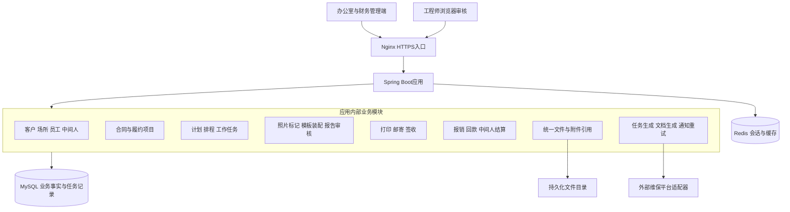
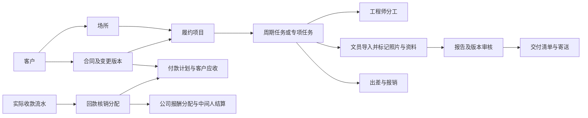
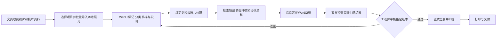
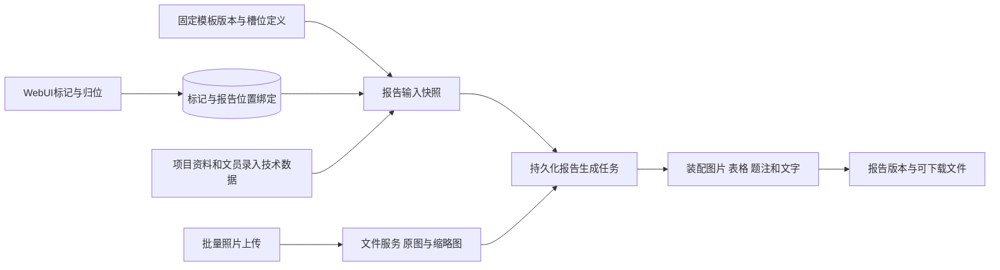

# 消防技术服务 ERP 系统设计方案

本文依据工作区 `1.md`、当前源码和本次沟通设计。除“现状”部分外，模块、表和流程均为建议方案，不表示已经开发完成。

后续按模块开发请以 [业务模块实施计划](MODULE_PLAN.md) 为入口：共 13 个逻辑模块，明确功能范围、数据归属、依赖、首版交付和验收标准。

## 1. 已明确的业务规则与设计假设

已明确：

- 业务分公司自营项目和中间人项目；服务类型为维护保养、消防检测、消防评定、消防评估。
- 中间人项目由甲方先付款到公司，公司再与中间人结算。
- 公司应得报酬按合同额乘约定比例计算，分期结算。
- 维保按月履约，现场使用外部维保软件，报告从外部平台生成，再打印两份寄给甲方。
- 维保负责人变更说明复用系统内项目和工程师资料，按模板生成；维保卡由用户填写、确认信息后直接生成可打印 PDF。
- 检测、评定、评估保留工程师现有拍照和交接方式；由文员从电脑批量选择照片，在 WebUI 中标记，后端按标记插入报告模板。
- 现场拍摄不依赖新增手机 App，也不要求工程师改用专门的手机网页采集流程。
- 出差费用需要报销，客户付款依合同节点和指定账户跟踪。

待业务确认的设计假设：

- 一份合同可以覆盖多个场所或服务类型；建议拆成多个履约项目管理。
- 分期结算时，建议按累计实际回款占合同额的比例，分摊已经确定的公司报酬总额。公司报酬的总基数仍为合同额。这种分摊节奏需要公司确认，不应直接写死。
- 工程师审核是默认技术审核节点；如公司还有终审或盖章授权，再增加相应节点。
- 初期保留外部维保软件和人工导出报告；外部 API 的存在、权限和调用规则尚未核实。

核心目标是把合同、项目、工作任务、现场资料、报告、寄送、报销、回款和中间人结算串成可追踪的业务链。

## 2. 当前基础与需要补齐的能力

现有 Java 17 / Spring Boot 3 / Vue 3 / MySQL / Redis / Quartz / Docker Compose 可以继续使用。当前已有合同、报告、代理人、维保卡、项目消防系统选择和统一文件管理的基础。

从当前实体和 Mapper 看，合同、报告、维保卡主要还是独立记录，尚缺少贯穿整个流程的项目、任务、排班、照片标记与模板映射、报告版本审核、交付和资金关联。`zjerp_project_system` 描述的是项目消防系统选择信息，不能直接承担完整项目履约管理。

几个应优先调整的现有细节：

| 当前情况 | 演进方向 |
| --- | --- |
| 合同负责人主要保存字符串 | 保存人员 ID；历史文档另外保存姓名和职务快照 |
| `ZjContract.amount` 使用 Float | 金额改为 MySQL DECIMAL / Java BigDecimal，明确舍入规则 |
| 报告以附件和最终版标记为主 | 增加任务关联、版本、审核意见和正式签发记录 |
| 维保卡以打印/邮寄布尔值为主 | 改为文档版本和交付清单，支持数量、退回、补寄 |
| 文件表上直接放业务类型、业务 ID | 后续分离文件元数据与业务附件引用，支持一份资料多处使用 |
| 项目系统详情及修改存在匿名接口 | 外勤入口改为登录授权，或限制到指定任务、有效期、字段的临时授权 |
| 业务数据以列表维护为主 | 增加项目总览和按角色分配的待办工作台 |

## 3. 总体架构：模块化单体

一期继续维护一个 Spring Boot 应用和一个 MySQL，按业务域组织代码。这样可以复用现有权限、部署与开发方式，也容易在同一事务中保证业务状态和资金关联一致。



模块之间通过应用服务交互，Controller 不直接跨业务域修改 Mapper。跨模块核心写入使用数据库事务；文档生成、通知、外部同步等耗时操作通过持久化任务异步执行。

现有 `zjerp-management` 可以先按 customer、project、contract、work、report、delivery、finance 分包，不必立即拆 Maven 模块。将业务文档生成逐步移出同时承担代码生成的 generator 模块，避免工具功能与正式报告生命周期混杂。

Redis 继续保存登录会话和缓存，不保存唯一一份业务任务、审核结果、应收或结算余额。清空 Redis 不应导致业务事实丢失。

文档量上来后，可以把文档任务处理器拆成独立容器；仍可使用相同代码仓库和 MySQL。当前没有必要先引入微服务、消息中间件或单独的搜索集群。

## 4. 业务主线和对象关系

客户、场所是长期档案；合同是商务约定；履约项目是具体执行单元。建议每个履约项目对应一个场所、一种服务和一个履约期间。

例如，同一合同同时包含 A 商场维保和 B 仓库检测，建立两个履约项目。场所下一年续约时，保留场所档案，建立新的合同履约期间，并关联上一期项目，保留旧人员、报告和结算历史。



合同总金额只在合同层计算一次。跨多个项目分摊金额或成本时使用分摊记录，避免每个项目都重复计入整份合同金额。

## 5. 合同确认后的自动准备

合同登记时集中录入客户、场所、服务内容、履约期限、责任人、付款节点、收款账户和项目归属。项目归属、实际签约主体、实际收款主体和执行负责人分别保存，支持中间人签约、公司收款并执行的实际情况。中间人项目还需要明确中间人、公司报酬比例及结算规则。

合同材料分别记录“照片已收到、扫描件已归档、原件已收到、原件已核验”，并记录原件保管位置、接收人、接收时间。原件追回独立生成待办；是否允许先排程或开工，由公司授权规则决定。

合同确认后，系统生成履约项目、责任人待办、周期或专项计划、付款计划及材料追踪。负责人更换时记录变更原因和生效时间，并按项目需要生成新的公示卡、更换说明和交付任务；已经签发的历史报告继续保留原责任人快照。

合同变更采用新版本及生效日期。修改金额、比例或期限后，系统列出受影响的未来计划、未结应收和待结算金额，由授权人员确认。已经付款或正式签发的历史记录通过调整记录处理。

## 6. 维保优化：模板文档、PDF 打印与月度交付

### 项目负责人变更说明

操作流程：选择项目 → 读取现任负责人 → 选择新负责人 → 填写变更原因和生效日期 → 自动填充模板 → 预览确认 → 生成并归档变更说明。

项目名称、地点、合同编号、服务范围来自项目/合同档案；新旧负责人的姓名、联系方式、模板实际需要的人员资料来自工程师档案。缺少模板必填字段时显示具体缺项，避免文员重新录入所有资料。本次文档的个别补充值与人员主档分开保存，防止修改一份说明时误改全公司的人员资料。

单纯预览不会改变项目负责人。确认后保存变更记录、生效日期和当时的项目及新旧人员快照，再由文档任务使用固定模板版本生成。未来生效的变更在相应日期更新现任负责人；历史报告和旧说明保留原有信息。生成失败显示待生成并可重试，不把一个空文件当作已完成文档。

说明的输出格式依实际模板确定，可以保留可编辑 Word 和确认后的打印 PDF。文员能够预览、重新生成草稿、下载和登记打印。

### 维保卡：填写信息后直接生成 PDF

流程：选择项目（可选带入已有资料）→ 用户填写或确认卡片字段 → 预览 → 后端填写 PDF 模板 → 下载或浏览器打印。

现有 `WBCard` 和 `WBCardUtils.genWBCard` 已具备 PDF 表单填充基础，可以沿用并完善。当前字段包括项目名称、单位、负责人、电话、系统信息、服务时间和编号。用户填写值优先作为本次生成输入，选择档案后可以带入默认值，最终内容由用户确认。

模板保存纸张尺寸、方向和字段布局；长名称、长地址或较多系统内容需要明确的换行/字号规则，预览中显示溢出，不能静默截断。中文字体与模板随部署提供。首期实现单项目 PDF 生成、预览、下载和打印确认，再按需要增加批量合并打印。

生成文件统一进入文件服务，使用受控的文件 ID / UUID 路径，不再使用项目名称直接拼接磁盘目录。每次生成保存输入快照、模板版本、生成时间和文件 ID；再次生成形成新版本，旧卡片和打印记录保留。

### 每月维保报告的交付跟踪


每个维保项目、每个服务周期只生成一条周期履约记录，月内多次到场或复访作为子任务。数据库唯一键保证重复执行调度不会生成两份同月义务。

周期记录关联计划日期、实际到场、工程师、外部项目/报告标识、本地报告文件、打印数量、寄送信息和异常说明。现场完成、报告归档和寄送分别跟踪；项目总览能直接看到“到场已完成，但本月报告未回传”等缺口。

外部平台一期采用授权导出后上传或批量导入，按项目与月份匹配并人工确认。保存远程 URL 的同时保存实际导出的报告附件；后续如果取得 API 权限，再增加适配器和失败重试。系统无需保存工程师个人账户明文密码，也不应假定外部平台支持自动获取报告。

Quartz 负责定期扫描持久化计划。生成范围、生成记录和待补任务存在 MySQL，应用重启后可补扫；不能只依赖内存调度状态。合同临近到期提醒与续约跟进可配置提前时间，合同到期后未完成的历史月份仍显示为欠交任务。

## 7. 检测、评定、评估：文员标记照片，后端装配报告

### 工作边界与完整流程

工程师继续使用现有手机和拍照工具，将照片及技术资料交给办公室。自动化从办公室的批量导入和标记开始，不增加工程师端 App 或现场录入要求。



### WebUI：照片标记工作台

建议采用左中右布局：左侧为消防系统、检查项或模板照片位置树；中间为缩略图网格和待标记列表；右侧为当前照片的大图、分类、位置、说明、顺序和具体报告位置。

文员选择项目、报告类型及模板版本，再通过多选文件批量导入。保存导入批次、原文件名、上传人、状态和重试记录。照片已有的拍摄信息可保留，缺少拍摄时间、定位或 EXIF 不阻止办公室标记；这些信息不作为生成报告图片布局的前提。浏览器选择的本地文件需要实际上传成功后才能由后端生成报告，本地路径不能作为服务器的图片地址。

工作台提供多选批量分类、拖拽归位、连续标记、键盘切换、撤销，以及按未标记、已标记、已排除、缺项筛选。项目和模板只选择一次；共有的楼层/设备分组可以批量继承。拖入目标类别或位置时同时保存标记与模板绑定，不要求文员重复完成两套同义录入。只显示当前模板需要区分的字段，尽量用一次批量操作完成一组照片归位。保存状态明确区分未保存、保存中、已保存和失败，离开页面时提示未完成上传或未保存操作。

大量照片使用后台缩略图和按需加载，界面不同时加载全部原图。原图及已有水印保留，展示旋转或报告用派生图另行记录；默认等比例完整显示，避免裁掉原有水印或检测读数。

### 标记内容与模板位置

这里的标记主要是数据库中的业务标注和位置绑定，不要求把标签文字写入原图像素。

| 标记内容 | 示例 | 作用 |
| --- | --- | --- |
| 消防系统 | 火灾自动报警、消火栓系统 | 按报告章节分类 |
| 检查项或对象 | 控制器、探测器、压力测试 | 定位表格内容 |
| 现场位置/对象分组 | 1号楼3层、2号设备 | 区分同类多处照片 |
| 照片用途 | 全景、铭牌、读数、现场结果 | 匹配对应图片位置 |
| 说明与顺序 | 本次测试说明、第1张、第2张 | 生成题注及排序 |
| 采用状态 | 使用、暂不使用、待确认 | 保留全部源图并明确取舍 |
| 报告位置绑定 | 某模板章节/重复表格行/图片槽位 | 决定实际插入位置 |

单纯一个“消火栓”标签不足以确定某栋楼、某层、某行表格。标记需要同时包含对象/位置分组和模板位置；同一照片确实需要多处使用时，可以建立多条引用，并在界面明确显示使用位置。

系统和用途使用受控字典，模板图片位置使用稳定编码，不以容易改名的中文标题作为数据库主键。具体标签和槽位应来自公司真实的三类模板样本，不预设所有报告共用一套检查结构。

### 模板图片槽位与装配规则

每个模板版本定义图片槽位，例如示例编码 `HYDRANT_PRESSURE_RESULT`。槽位包括章节/表格锚点、适用对象分组、允许数量、必需性、图片尺寸、排版和题注规则。以上是示例编码，实际含义由模板确认。

标签可帮助筛选候选图片，明确的槽位绑定、对象分组和排序决定最终插入位置。标签匹配只有唯一候选且规则明确时才可自动建议；有歧义时让文员确认。后端不凭照片文件名或上传先后顺序猜测位置。

一槽一图、多图网格、按对象重复表格分别建模。重复内容按对象分组展开行或区块，不固定为某个页码，因为插图后页码可能变化。

校验规则：必需槽位无图、单图槽位多图、来源文件不可用、照片仍在上传、待确认冲突，以及模板必填文字/数据缺失。草稿可显示缺项并继续整理，正式送审前校验必须项；允许不适用的项目由业务规则和人工确认并记录理由。

### 后端生成架构



生成任务固定模板版本、项目资料、文员录入的技术数据、已采用照片 ID、对象分组、槽位绑定、顺序及图片展示参数。照片只负责图像资料，测量值和技术结论由文员依工程师提供的资料录入、工程师审核，不默认从照片自动识别出完整报告数据。

生成过程中采用数据快照；文员继续修改标记时，当前任务仍按原快照完成。重新生成使用新快照并产生新版本。并发编辑使用版本校验，防止不同文员互相覆盖标记结果。

后端生成 Word 后，文员检查实际生成文件；预览方式可先下载打开 Word，待真实模板的 PDF 转换效果通过验收后再增加在线预览。重点验收跨页表格、横竖照片、长说明、重复区块、中文字体和水印完整显示，WebUI 归类视图不等同于 Word 最终分页效果。

### 报告审核与版本

报告审核针对不可变的具体版本，例如 V3。退回意见指向段落、表格项或照片位置。审批通过后锁定该版本的内容和附件；修改内容必须产生 V4 并重新提交。手工 Word 编辑后的文件也作为新版本回传，并记录关键变更，不默认已经同步回结构化数据和照片绑定。

正式签发保存模板、资料、图片绑定、生成文件、审核和操作人快照。后续更新人员、项目或模板，不会静默改变已经出具的历史报告。

## 8. 排程与待办

排程同时考虑人员可用时间、请假、出差和任务冲突，以及服务所需能力和公司认可的资格有效期。区域距离、连续出差和项目熟悉程度可作为推荐排序条件。

系统推荐可用人选，调度员确认。确认时由 MySQL 事务重新检查并锁定相关人员的排程记录，避免两个调度员同时安排同一人员。任务延期、拒单或人员更换保留原因与处理记录。

每项业务待办都明确责任人、截止时间、完成条件、阻塞原因和下一步动作。通知只是提醒入口，待办状态以数据库为准；同一事件的重复提醒合并，避免通知堆积。

建议的角色工作台：

| 角色 | 主要待办 |
| --- | --- |
| 办公室 | 合同原件、资料缺项、待编报告、待打印、待寄送 |
| 调度员 | 待派工、人员冲突、延期、人员变更 |
| 工程师 | 我的现场任务、补充资料、待审核版本 |
| 财务 | 待核销回款、到期应收、待报销付款、待结算中间人 |
| 负责人 | 履约逾期、交付欠项、回款逾期、结算余额及跨部门阻塞 |

## 9. 报销：从项目和出差任务带入

出差任务关联项目、员工、日期、区域和可选预算。员工在出差过程中上传发票并录入金额、费用日期、类别、用途，系统带入出差和项目关联，返程后汇总提交。

建议流程为草稿 → 提交 → 业务负责人确认 → 财务审核 → 待支付 → 已支付。小团队可配置合并审核节点；审核通过与实际付款分别记录。退回原因、修改版本、付款人、支付流水和分次付款需可追踪。

重复票据可按票据号码与其他可用信息提示人工核对；OCR 可以预填，由员工和财务确认。报销附件按业务权限访问。

费用跨多个项目时保存分摊金额，分摊合计等于报销行金额。发生费用、审核通过、实际支付分别用于不同统计。中间人承担的代垫或扣款需要单独约定和确认，不会把所有项目费用直接当成结算扣款。

## 10. 回款与中间人分期结算

### 分开记录三个金额与一份实际流水

- 客户合同应收：甲方按合同应付的款项及节点。
- 公司应得报酬：公司项目为自营业务约定报酬；中间人项目为合同额乘约定比例。
- 中间人应结算金额：按约定从已收到的款项中分配并最终支付的部分。
- 实际收款流水：付款人、收款账户、日期、金额、银行流水号或其他唯一依据。

客户付款计划在合同确认时建立。付款触发条件支持固定日期或经确认的业务事件，如合同确认、报告签发、客户验收；规则与合同一致。因此回款追踪从合同阶段开始，和履约、报销并行。

一笔收款可以核销多个付款节点或多份合同，一个节点也可以被多笔收款分次核销。`receipt_allocation` 记录对应金额；未分配余额保留为待认领。匹配金额不得超过流水余额或相应应收余额，超额及异常情况进入单独确认。

### 已确定的计算口径与建议的分摊方式

设合同额为 C，公司比例为 r，公司应得总额 F = C × r，中间人基础应得总额 A = C − F。这是业务结算台账的口径，具体账务与税务处理由财务确认。

总公司报酬按合同额确定。建议各期按累计已核销回款比例分摊，采用累计计算处理尾差：

```text
截至本期公司累计已分配报酬 = 按约定舍入(F × 累计已核销回款 / C)
本期公司分配 = 公司累计已分配报酬 − 前期公司已分配报酬
本期中间人基础结算额 = 本期已核销回款 − 本期公司分配
```

该公式适用于合同额大于零、累计核销未超过合同额、没有特殊分摊安排的情况；分期分摊节奏仍需公司确认。变更、退款、超额收款和扣款使用调整流程，不直接套用普通公式。

示例：合同 100,000 元，公司比例 20%，公司总报酬 20,000 元，中间人基础总额 80,000 元。

| 期次 | 本期已核销回款 | 公司分配 | 中间人基础结算额 |
| --- | ---: | ---: | ---: |
| 第一期 | 40,000 | 8,000 | 32,000 |
| 第二期 | 60,000 | 12,000 | 48,000 |
| 合计 | 100,000 | 20,000 | 80,000 |

合同尚未收齐时，剩余报酬显示待回款分配，不自动视为减免。付款前还要扣除已结算、审批占用和冻结等金额，避免同一笔款被两张结算单重复使用。

### 结算控制

规则随合同版本固定，结算单保存当时采用的合同金额、比例、回款核销明细、分摊结果、调整项和收款人账户快照。

结算单经过确认后进入待支付，付款后由支付流水核销，支持分次支付。实际退款、合同调减或核销纠错通过冲销/调整单追踪。应收、核销、结算占用和支付使用事务及并发版本校验，银行流水或导入批次明确去重规则。

金额使用 DECIMAL(18,2) / BigDecimal，比例用固定精度小数。历史 Float 金额转换需与合同和财务凭据核对，类型转换本身不能恢复已经丢失的精度。舍入规则由公司确认，尾差在累计分配中处理。经营台账分别显示客户应收未收、公司报酬已分配、应结算中间人、已付款和待支付余额。

## 11. 状态机与异常处理

不要把所有进度压进一个“项目状态”。项目总览分别展示履约、报告、交付、回款、报销和中间人结算。

| 对象 | 建议主要状态 |
| --- | --- |
| 合同 | 草稿、已确认、履约中、到期、终止 |
| 工作任务 | 待排程、已派工、执行中、待补资料、资料齐备、已完成、已取消 |
| 报告版本 | 草稿、待审核、退回、已通过、已签发、已作废 |
| 交付单 | 待打印、已打印、待寄送、已寄出、已签收、异常 |
| 报销单 | 草稿、审核中、退回、待支付、部分支付、已支付 |
| 中间人结算单 | 草稿、待确认、待支付、部分支付、已支付、已冲销 |

收款状态由应收及核销明细计算，不允许通过手工把项目改为“已回款”替代真实流水。整体关闭条件由公司确认，可以要求履约交付完成，并且资金未结事项已清理或有明确批准。

每个状态变更保存事件、操作人、时间、原因和前后版本。迟到、资料缺失、客户取消、邮寄退回、报告修订、合同变更都应有异常入口。打印和寄送使用交付行关联具体报告/维保卡版本，记录份数、收件地址快照；补寄是新的交付记录。客户后续修改地址不改变历史寄送信息。

## 12. 数据模型建议

这些表按阶段新增，实际名称按现有命名规范统一；不要求首期一次建齐。

| 领域 | 核心表或对象 | 关键内容 |
| --- | --- | --- |
| 基础资料 | customer、site、employee_profile；复用 biz_agent | 客户、场所、员工能力、中间人 |
| 合同 | 扩展 zj_contract、contract_revision | 金额、归属、比例、有效期、签约/收款关系、版本 |
| 履约项目 | service_project、project_member、project_change | 合同与场所关联、服务类型、期间、人员、变更 |
| 计划任务 | service_plan、service_period、work_order、assignment | 周期、排程、参与人、完成条件 |
| 照片整理 | photo_import_batch、project_photo、photo_mark | 本地照片导入批次、原图引用、系统/用途/位置等业务标记 |
| 模板图片装配 | template_image_slot、report_photo_binding | 版本化槽位、对象分组、照片顺序及报告位置绑定 |
| 技术资料 | inspection_item、inspection_record | 文员依工程师资料录入的技术数据、单位和说明 |
| 报告 | 扩展 zj_report、report_version、review_action | 项目/任务关联、数据快照、文件版本、审核 |
| 模板文档 | document_template、template_version、generation_job、project_change | 负责人变更说明、维保卡 PDF、报告装配任务与输入快照 |
| 交付 | delivery_order、delivery_item、delivery_event | 文档版本、数量、地址、物流和异常 |
| 报销 | trip、expense_claim、expense_line、expense_allocation、expense_payment | 出差、费用明细、项目分摊和支付 |
| 客户回款 | receivable_plan、receipt、receipt_allocation | 付款节点、收款流水及核销 |
| 中间人结算 | settlement_rule、settlement_statement、settlement_line、settlement_payment | 规则快照、分期分配、占用及支付 |
| 文件 | sys_file、business_attachment | 文件元数据与业务用途关联 |
| 运行追踪 | workflow_event、outbox_event、job_execution | 状态变更、可靠待执行事项、重试 |

为现有报告、合同和维保卡增加关系 ID 时，先建立旧数据映射。无法确定归属的记录进入“待关联”清单，不能仅凭名称相似度批量绑定。历史已完成项目不补发执行任务、提醒或应收。

## 13. 文件、权限与任务可靠性

### 文件与业务引用

复用目前的统一文件表和标准存储路径。后续增加业务附件引用表，记录 file_id、对象类型、对象 ID、用途、顺序和引用版本。一份照片可以被照片标记和多个报告位置引用；同一份凭据可以被合适的费用记录引用，物理文件不因某处解除关联而立即删除。

已有 sys_file 上的 biz_type / biz_id 可通过兼容读取逐步迁移到引用表，原文件无须再次移动。暂时没有原文件的旧记录继续保留元数据和路径，增加可用状态，待真实文件补回后再核验大小与哈希。

正式报告、合同、现场照片和报销发票需要对象级访问控制。文件下载权限应沿着附件关联检查项目、任务、财务或本人权限。现有公开 `/profile/**` 模式需要分阶段收敛，新财务附件先走鉴权下载；需要外部交付时再提供用途受限、到期失效的下载授权。

### 数据权限

复用现有 RBAC，额外增加项目成员、任务分工和费用归属的数据范围。工程师访问被指派的项目与任务；文员处理被授权项目的材料与报告；财务管理核销、报销和结算；跨项目汇总限定负责人权限。

前端菜单和按钮控制只负责展示，后端在详情、列表、导出、修改、审核和下载中统一校验。中间人若暂不登录，则由内部人员维护其对账单，不必首期建设外部门户。

### 可靠异步处理

业务事务同时提交核心变更和 outbox 待处理记录。处理器领取任务后生成文档、创建待办或发通知，保存成功、失败、重试次数和下一次执行时间。

任务可能被重复领取或重试，因此每项操作有幂等标识和数据库约束。通过领取租约、超时恢复和有限重试避免任务永久卡住。任务生成和消息发送采用至少一次执行的思路，不宣称跨数据库、文件和外部平台存在天然的整体事务。

报告生成限制并发，使用不可变的数据快照；即使后台异步任务重试，也不能生成内容不同却版本号相同的正式报告。上传失败和回滚按现有文件补偿机制处理，未引用文件的清理与保留策略另行配置。

## 14. 流程优化与衡量方式

| 当前工作 | 优化方式 | 可衡量指标 |
| --- | --- | --- |
| 同一客户、项目资料反复输入 | 客户/场所档案及合同带入项目 | 重复录入字段数、资料纠错次数 |
| 手工修改项目负责人说明 | 从工程师/项目档案带入模板并固定变更快照 | 重复录入字段数、说明生成耗时 |
| 手工排版维保卡 | 用户填表、预览并直接生成打印 PDF | 卡片生成耗时、溢出和重打次数 |
| 收到照片包后逐张找位置 | WebUI批量导入、标记、分组和归位 | 标记耗时、未标记数量、位置绑定纠错次数 |
| 文员逐张插图、反复调整表格 | 按照片标记及位置绑定自动装配模板 | 单份报告插图/排版耗时、返工次数 |
| 审核意见散落在聊天中 | 针对具体报告版本和检查项反馈 | 审核周期、版本退回次数 |
| 每月靠记忆追报告和寄送 | 周期履约任务与交付清单 | 当月按期交付率、未归档/未寄送数量 |
| 出差后集中找票据 | 出差任务中随手记录费用和上传票据 | 退回率、从提交到支付周期 |
| 收款后手工算中间人分成 | 合同规则快照、流水核销、分期结算单 | 未核销金额、未付结算余额、调整次数 |
| 看不出项目卡在哪个环节 | 多维进度和责任人待办 | 超期任务数、阻塞时长 |

先统计当前基线，再设置目标，不预先承诺没有依据的节省比例。经营看板的项目成本与利润类指标必须显示纳入的成本范围，只有报销数据时不能把计算结果当作完整项目利润。

## 15. 分阶段落地

### 第一阶段：项目/工程师资料与维保文档

完善工程师档案与项目关联，复用现有 PDF 填充能力，实现负责人变更说明模板生成、维保卡信息确认、PDF 预览/下载/打印，以及文件归档和版本快照。

验收：文员选择项目和新工程师即可生成资料正确的变更说明；填写维保卡后能得到符合实际纸张及排版要求的 PDF；重生成不覆盖历史文件，业务名称不参与磁盘路径。

### 第二阶段：照片工作台与一种报告模板试点

选择一份高频的真实报告模板，定义图片槽位和对象分组；实现本地批量导入、缩略图、批量标记、归位排序、缺项检查及后端 Word 装配。工程师沿用现有拍照工具和照片交接方式。

验收：文员整理一批真实照片后，图片按确认位置和顺序进入模板；模板必需项的缺失或冲突可以定位；实际生成文件的表格、分页、方向、水印和题注可用。

### 第三阶段：项目流程、回款与分期结算

串联合同、项目、周期履约、派工、报告版本审核、打印寄送，以及客户回款核销和中间人结算；同步修正金额精度和补充责任人工作台。

验收：项目能追踪至报告交付、客户回款和中间人支付；状态及金额能核对；同月义务、正式报告和结算操作不会重复生成。

### 第四阶段：覆盖三类报告并完善费用与集成

将试点装配规则扩展到检测、评定、评估的其他模板，完善多文员协作、报销与支付、费用分摊及经营看板。外部维保平台同步和 OCR 预填按实际权限和样本效果另行推进。

验收：模板升级保留旧报告版式和图片绑定；不同服务类型使用各自模板规则；费用可追到项目，外部同步失败可重试。报销若更紧急，可提前上线简化版本。

## 16. 下一步的业务确认清单

- 确认公司报酬在各期回款中的具体分摊节奏；合同额基数和分期结算已经明确。
- 是否存在同一合同覆盖多个场所、多个服务类型，以及续约沿用编号的情况。
- 提供项目负责人变更说明模板、维保卡 PDF 模板，确认实际字段和纸张布局。
- 三类报告各提供一份完整样本、原始模板和对应原图包，列出必须由工程师判断的内容。
- 由文员和技术人员一起确认照片标签、对象分组、图片槽位、多图排版及允许不适用的规则。
- 确认标记后的照片是否需要在一份报告中重复使用、模板是否存在按楼层/设备重复的表格。
- 确认工程师审核后是否还有终审、盖章和签发权限。
- 确认代垫、扣款、退款、变更和中间人结算争议的处理规则。
- 确认外部维保平台的授权导出和接口条件，再决定自动同步范围。

以上确认完成后，先绘制负责人变更、维保卡 PDF 和照片标记工作台原型，用真实模板及原图完成装配验证，再细化表结构和功能开发。
