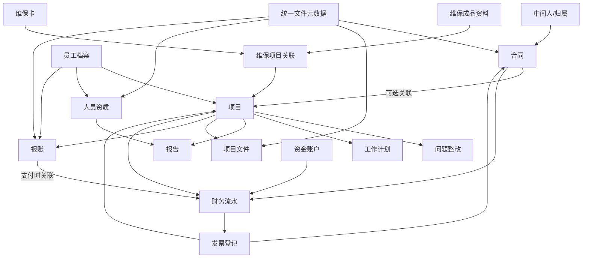

# 现有 ERP 现状审计基线

> 版本：v0.1；日期：2026-11-21。基于当前仓库代码、SQL 与 codex 文档静态审阅。没有连接生产数据库，也没有读取生产数据；因此本文只记录代码可证实事实，不推断实际业务发生频率或生产数据完整性。

## 1. 当前技术与部署形态

- 后端为 Java 17 / Spring Boot 3 / Maven 多模块，业务主要集中在 `zjerp-management`，认证、用户、角色、文件等能力位于系统/框架模块；MyBatis 负责数据访问。
- 前端为 Vue 3 / Vite / Element Plus，当前仓库独立于后端仓库；后端仓库承担 Compose 与数据库初始化/部署链路。
- 当前代码采用单体部署形态，不需要在新系统中预设微服务。目标架构优先采用边界清晰的模块化单体，待真实规模与独立部署需求证明后再拆分。

## 2. 当前可确认业务域与对象

| 业务域 | 当前可见对象/表 | 主要关系与事实 | 审计状态 |
|---|---|---|---|
| 合同与中间人 | `zj_contract_identity`、五类合同表、`zj_intermediary` | 合同以统一 identity ID 关联不同类型合同表；合同可记录公司/中间人归属；金额 DECIMAL | 已确认表结构；完整约束仍需检查 |
| 项目 | `zj_work_project`、`zj_work_project_issue`、`zj_work_project_plan`、编号/历史映射表 | 项目按 WB/JC/PD/PG/QT 分类；可关联合同；项目有问题、计划、负责人和编号 | 已确认 |
| 项目档案 | `zj_project_document`、`sys_file` | 项目文件记录引用统一文件元数据；移除业务关联不应删除磁盘原件 | 已确认主要实现 |
| 维护保养资源 | `zj_wbcard_material`、`zj_wbcard`、`zj_project_material` | WB 项目可关联成品资料与维保卡；生成和关联具有事务/版本控制 | 已确认主要实现 |
| 人员与资质 | `zj_employee`、`zj_report_credential`、`sys_user` | 员工档案与登录账号分离；资质可归公司或员工；旧账号资料有迁移来源 | 已确认主要实现 |
| 报告 | `zj_inspection_report`、`zj_report_credential` 及报告生成代码 | 报告关联项目，报告数据包含快照；生成流程使用员工和资质 | 已确认部分；各类报告覆盖需继续盘点 |
| 报账 | `zj_reimbursement` | 报账可关联项目和员工；保留录入人、申报人、来源、状态和幂等标识 | 已确认 |
| 财务账本 | `zj_finance_account`、`zj_finance_transaction`、`zj_finance_invoice` | 流水影响账户余额；收入/支出/内部转账；流水可关联合同、项目、报账、发票；发票可关联合同/项目 | 已确认主要实现 |
| 身份与权限 | `sys_user`、`sys_role`、`sys_menu`、`sys_role_menu` 等 | 菜单权限与后端权限检查共同构成授权；前端隐藏按钮不是安全边界 | 已确认 |
| 文件基础设施 | `sys_file` 与上传目录 | 文件元数据和业务引用分离；历史文件可能只有 URL/元数据，文件哈希和大小可能未知 | 已确认表结构；文件实际完整性未核验 |

## 3. 已观察到的跨模块关系

图中实线表示代码/表结构可确认的引用方向，不表示所有业务基数、状态约束和完整生命周期均已确认。文件关系是通过业务类型和业务 ID 建立的多态引用，需继续核查权限与引用完整性。

## 4. 当前架构的主要结构性问题（静态审计发现）

1. **合同类型分表**：五类合同字段高度重复，统一 identity 表再连接类型表；新模型应评估统一合同实体 + 类型扩展/属性的设计，不应直接复制五套表。
2. **业务引用与兼容字段混杂**：项目/员工等字段存在历史 user ID、employee ID 迁移兼容；新模型应清楚区分人员主体、系统账号和操作审计主体。
3. **多态文件关联**：`sys_file.biz_type + biz_id` 缺少数据库级业务外键；新系统应设计明确的文档/附件引用实体和授权策略。
4. **报账与现金流水分开**：现有语义正确地区分申请和实际付款，但生命周期、付款分摊/部分付款、冲正等仍需明确。
5. **发票、收款和对账并非同一对象**：当前已有开票登记和现金流水，需继续核查收款业务表达、合同应收口径及是否存在付款计划/应收计划。
6. **状态分散**：项目、问题、计划、报账、流水、发票各自有状态；跨域“完成/结清/归档”尚未形成统一业务流程视图。
7. **历史迁移复杂度被文档低估的风险**：部分旧记录存在待确认合同、编号、分类或归属；文件哈希/大小未知；不能用姓名相同或文本相似自动合并主体。

## 5. 关键迁移基线（来自历史发布文档，不是当前生产实时统计）

- 历史发布记录曾报告：合同 380 份；项目 497 个（其中 2026-10-29 前后迁移统计存在不同阶段口径）；文件记录 1574 条；报告迁入 497 条项目文件记录；历史维保卡 291 条。
- 历史财务发布记录指出：历史账面汇总与明细存在差异（0 元与 100 元分别保留），曾有 1 笔 100 元历史报账进入新账册；未补造历史账户、开票和流水。
- 以上是历史发布文档中的阶段性数字。正式迁移必须重新从源库统计、抽样并核对，不可把这些数字当成当前生产数据快照。

## 6. 需要继续验证的事项

- [ ] 下载并解析全部 Mapper XML，建立每个 API 到表/SQL 的完整调用图。
- [ ] 逐项审计五类合同的共同字段、类型差异、付款计划、金额精度和附件引用。
- [ ] 审计所有报告类型、模板、快照字段和签字/资质依赖。
- [ ] 盘点项目类型、状态、编号规则及历史映射，检查未关联/待确认数据。
- [ ] 审计发票、流水、报账三者的全部状态转换、作废、支付、幂等和并发边界。
- [ ] 核查是否存在真实的收款/应收/合同付款计划实体；不能只从当前 UI 标签推断。
- [ ] 盘点所有文件来源、存储路径、业务引用和缺失文件标记；校验原件 hash。
- [ ] 对照动态菜单 SQL、前端路由、API 和后端权限注解形成权限矩阵。
- [ ] 使用脱敏生产快照在隔离环境做只读盘点，确认实际行数、孤立引用、重复数据与待确认数据。
- [ ] 与业务负责人确认跨项目费用、部分付款、退款、合同变更、项目终止、报告更正等未定义规则。

## 7. 审计边界

此文件不是最终目标模型。现有实现可能有未被静态代码审阅发现的运行时行为；所有目标设计应以业务事实为依据，旧实现只作为迁移来源。生产数据和附件均未在本轮静态审计中读取或更改。