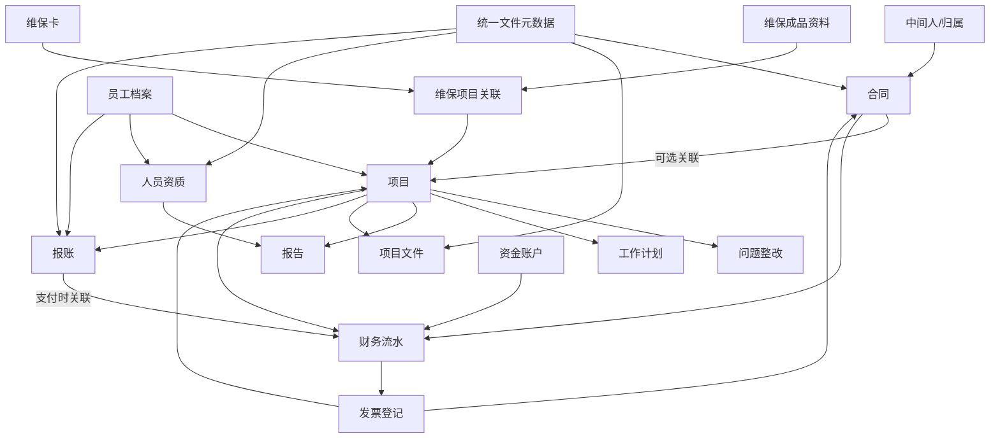

# 现有 ERP 现状审计基线

> v0.2 / 2026-11-21。基于当前仓库代码、SQL 与项目文档静态审阅。没有连接生产数据库，也没有读取生产数据；本文只记录代码可证实事实，不推断生产数据完整性或真实业务发生频率。

## 1. 技术与部署

- 后端：Java 17 / Spring Boot 3 / Maven 多模块；业务主要在 `zjerp-management`，MyBatis 负责数据访问。
- 前端：Vue 3 / Vite / Element Plus，独立仓库维护。
- 后端仓库包含 Compose、数据库初始化和部署链路。
- 当前形态是单体部署。新系统可以采用模块化单体，不需要预设微服务。

## 2. 当前可确认业务域

| 业务域 | 当前对象/表 | 可确认关系 | 状态 |
|---|---|---|---|
| 合同/中间人 | `zj_contract_identity`、五类合同表、`zj_intermediary` | identity 统一合同 ID，按类型存放扩展表；合同记录公司/中间人归属 | 表结构已确认 |
| 项目 | `zj_work_project`、issue/plan/number/legacy 表 | WB/JC/PD/PG/QT 类型；可关联合同；有问题、计划、编号和人员字段 | 已确认 |
| 项目档案 | `zj_project_document`、`sys_file` | 项目文件引用统一文件元数据；删除业务关联不等于删除磁盘原件 | 已确认 |
| 维保资源 | `zj_wbcard_material`、`zj_wbcard`、`zj_project_material` | WB 项目关联成品资料与维保卡 | 已确认主要实现 |
| 人员/资质 | `zj_employee`、`zj_report_credential`、`sys_user` | 员工档案与登录账号分离；人员资质绑定员工，报告读取资质 | 已确认主要实现 |
| 报告 | `zj_inspection_report` 及报告生成服务 | 报告关联项目并保存快照；报告生成依赖员工与资质 | 需继续盘点所有类型 |
| 报账 | `zj_reimbursement` | 可关联项目/员工；保存申报人、录入来源、状态、凭证、幂等 token | 已确认 |
| 财务 | `zj_finance_account`、`zj_finance_transaction`、`zj_finance_invoice` | 流水影响账户余额；可关联合同/项目/报账/发票；发票可关联合同/项目 | 已确认主要实现 |
| 身份权限 | `sys_user`、`sys_role`、`sys_menu`、`sys_role_menu` | RBAC/菜单权限及服务端检查 | 已确认 |
| 文件 | `sys_file`、上传目录 | 元数据与业务引用分离；历史文件可能只有 URL，hash/size 未知 | 结构已确认，原件未核验 |

## 3. 现有模块关系图

图示是当前已发现的引用关系，不代表完整基数或状态机。文件通过 `biz_type + biz_id` 多态引用，需继续核查访问控制与完整性。

## 4. 主要结构性问题

1. 五类合同共享字段重复，另设 identity 表统一 ID；新模型应重新评估统一主体和类型扩展。
2. 人员迁移后仍有兼容字段名如 `leaderUserId`，其业务值可能已经是 employee ID，易混淆人员主体与登录账号。
3. 文件多态引用缺少数据库层面的业务外键，授权和引用完整性依赖服务逻辑。
4. 报账申请与现金流水分离是正确的语义方向，但部分付款、跨项目分摊、冲正等生命周期尚未明确。
5. 发票登记、收款、到账、应收和核销是不同事实；目前 Controller 中可见发票登记和流水 API，尚未看到完整收款核销流程。
6. 项目、问题、计划、报账、流水、发票分别维护状态，跨域完成/结清/归档视图尚未形成统一模型。
7. 历史数据有待确认合同、编号、分类、归属；文件 hash/size 可能未知，不能按姓名或文本相似度自动合并主体。

## 5. 历史发布文档中的迁移基线

历史发布记录曾报告合同 380 份、项目 497 个、文件记录 1574 条、报告迁入 497 条项目文件记录、历史维保卡 291 条。历史财务发布记录也指出旧账面汇总与明细有差异，曾保留 0 元汇总与 100 元明细，并有 1 笔 100 元历史报账进入新账册。

这些是不同历史发布阶段的统计，不是当前生产快照。正式迁移必须重新从源库统计、抽样和核对。

## 6. 现有迁移工具现状

仓库已有 `migrate-work-projects.py`、`migrate-project-finance.py`、`migrate-employees.py`、`migrate-file-metadata.py` 和应用内 `FileMigrateService`。它们面向旧系统到当前 ERP 的分阶段升级，不是全新目标模型的统一迁移平台。

工具之间预演能力、权限要求、执行方式、备份、checkpoint 和报告格式不统一；部分脚本要求 `--apply`，员工迁移脚本则没有只读预演模式。文件元数据登记也不代表原件复制或 hash 校验。新迁移平台应独立实现，不应简单串接这些脚本。

## 7. 后续审计清单

- [ ] 下载并解析所有 Mapper/SQL，建立 API → Service → Mapper → 表的调用图。
- [ ] 逐项审计五类合同字段、金额精度、付款计划、补充协议与附件。
- [ ] 审计所有报告类型、模板、快照字段、签字/资质依赖。
- [ ] 盘点项目类型、状态、编号规则、历史映射和未确认关联。
- [ ] 审计报账、支付、流水、发票的状态转换、作废、并发与幂等。
- [ ] 核查是否存在正式收款、应收、核销和合同付款计划实体。
- [ ] 盘点所有文件来源、存储路径、业务引用、缺失文件标记并核验原件 hash。
- [ ] 对照动态菜单、前端路由、API 和后端权限注解形成权限矩阵。
- [ ] 在隔离环境使用脱敏生产快照只读盘点实际行数、孤立引用、重复数据与待确认项。
- [ ] 确认跨项目费用、部分付款、退款、合同变更、项目终止、报告更正等业务规则。

## 8. 审计边界

本文是静态审计基线，不是生产数据验收。目标设计应以真实业务事实为依据；旧实现只作为迁移来源。生产数据和附件尚未读取或更改。