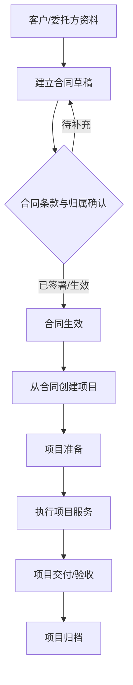
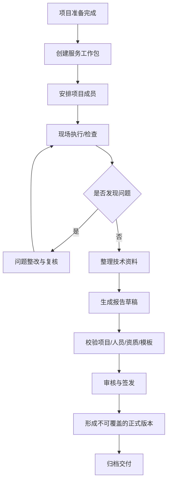
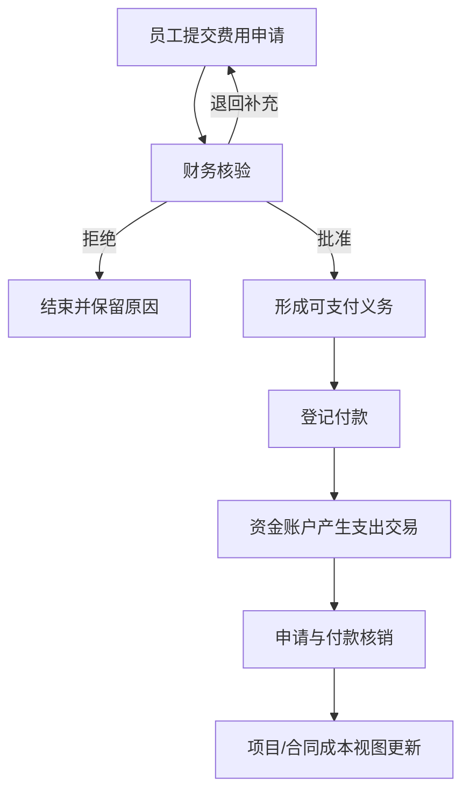
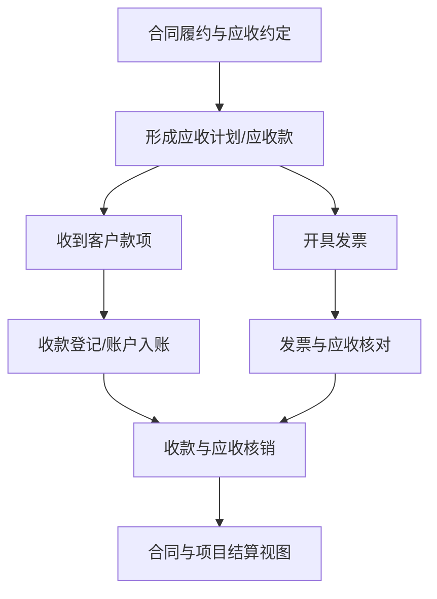

# 跨业务域交互与流程模型（提案）

> v0.1 / 2026-11-21。本文将模块关系从“谁引用谁”提升到“谁负责什么、谁触发什么、数据如何流动”。所有带“待确认”的分支不作为已确定业务规则。

## 1. 模块职责与数据所有权

| 业务域 | 拥有的事实 | 不应拥有/复制的事实 | 对外提供 |
|---|---|---|---|
| 客户与商业关系 | 客户主体、联系人、渠道/中间人关系 | 合同金额、项目执行状态、收付款 | 客户档案、联系人、关系摘要 |
| 合同商务 | 合同条款、合同类型、签署/履约状态、合同变更 | 项目现场进度、实际现金余额、发票到账状态 | 合同详情、合同项目关联、履约约定 |
| 项目交付 | 项目基本信息、项目生命周期、项目成员、问题/计划 | 合同原始金额、员工资质原件、财务流水 | 项目工作台、项目上下文、项目进度 |
| 人员与组织 | 员工/外部人员档案、任职角色、资质有效期 | 登录凭据、业务操作日志、报告历史快照 | 人员候选、资质状态、人员详情 |
| 技术服务 | 服务工作包、检查/现场过程、服务结果 | 合同商务条款、全局文件二进制、账户流水 | 服务执行状态、报告生成所需数据 |
| 报告与交付 | 报告草稿/签发版本、模板版本、签发快照 | 当前员工主档值、可变资质当前状态 | 报告版本、签发记录、交付清单 |
| 财务与结算 | 报账、应收/应付、发票、资金账户、资金交易、核销关系 | 项目基本资料、合同主档、人员主档 | 费用/收付款状态、账户余额、对账视图 |
| 文档档案 | 文件二进制、元数据、版本、业务引用与访问策略 | 业务状态、合同/项目事实 | 文档引用、下载授权、版本与完整性 |
| 工作流 | 明确分配的待办、负责人、期限、提醒 | 不复制业务对象的权威状态 | 我的待办、逾期、跨域工作队列 |
| 平台身份权限 | 账号、角色、权限、会话、审计操作者 | 员工业务档案、报告签字人身份事实 | 认证主体、授权决策、审计上下文 |

客户主档是否单独建立、外部人员是否纳入 Workforce，需结合真实业务数据确认。

## 2. 允许的跨域交互方式

### 查询
- 通过目标域公开 Query Service 读取摘要，不直接查询其他域私有表。
- 跨域详情由应用层组合多个摘要；页面可以显示关联信息，但不复制成可编辑字段。
- 查询结果注明来源、更新时间和权限过滤结果。

### 命令
- 写入只发送给拥有该事实的业务域。
- 跨域用例由 Application 层编排，统一事务和授权；例如“批准报账并登记付款”不能由前端连续调用两个无关联的 CRUD 接口伪造成功。
- 所有跨域命令校验引用对象存在、状态合法、操作者有权操作。

### 领域事件
- 首期使用进程内、事务提交后发布的领域事件/Outbox（仅当需要异步任务时）。
- 事件只通知事实变化，不复制全量实体。
- 消费者必须幂等；失败可重试；事件记录有版本与追踪 ID。
- 不为每个简单调用引入消息队列或最终一致性。

## 3. 关键业务旅程

### 3.1 商务签约 → 项目履约

- 合同创建不必然创建项目；一个合同是否可拆多个项目需要业务确认。
- 项目可以从合同上下文创建并继承客户/地址等默认信息，但必须保留字段来源。
- 如果历史项目缺少合同关联，进入“待确认合同”队列，不按项目名称自动补绑。
- 合同变更/补充协议不应覆盖历史合同条款；需定义变更生效范围。

### 3.2 项目 → 服务工作包 → 报告

- 项目是执行上下文；工作包记录某项服务的具体过程。
- 一项目是否有多份报告、一份报告是否涵盖多个工作包，需按现有报告类型和真实样本确定。
- 签发报告保存当时的项目数据、员工姓名/角色、资质信息和模板版本快照。
- 资质过期或人员停用后，历史报告仍显示签发时快照，不反向改写。

### 3.3 费用申请 → 审核 → 付款

- 费用申请与付款交易分离；批准不是付款。
- 若一笔申请可分次付款，应有多条付款核销关系；若允许多项目分摊，应有 allocation 行并明确总额约束。
- 现金交易只有入账后才影响账户余额；作废/冲正保留原交易和原因。
- 需要业务确认审批人、审批层级、部分支付、跨项目分摊和退款处理。

### 3.4 合同应收 → 发票 → 到账 → 核销

- 发票开具、客户到账和应收核销是三个不同事实。
- 是否存在应收计划、分期付款、预收款、部分核销与红字发票，需要确认。
- 如果当前业务只做发票登记和现金流水，目标系统可分阶段上线完整核销，不应在第一版虚构历史收款。

### 3.5 文档与档案

业务域创建文档引用；Document 域负责二进制存储、版本、hash 和访问授权。删除业务引用只解除关系，不默认删除文件原件。一个原件可有多个业务引用；每个引用保留来源、创建人、创建时间和访问策略。

## 4. 状态与派生视图的分离

| 概念 | 权威来源 | 不应由什么推导 |
|---|---|---|
| 合同生效/终止 | 合同域 | 项目是否完成 |
| 项目执行完成 | 项目/服务交付域 | 合同是否结清 |
| 报账批准 | 费用申请域 | 资金账户余额 |
| 实际已支付 | 资金交易 + 支付核销 | 报账状态文字 |
| 已开票 | 发票域 | 客户已付款 |
| 已收款 | 收款/账户交易域 | 发票金额 |
| 已核销 | 对应核销关系 | 两笔金额恰好相等 |
| 账户余额 | 期初余额 + 已入账交易 | 手工维护的多个余额字段 |
| 档案已归档 | 档案域 | 项目状态自动完成 |

## 5. 页面如何呈现跨域关系

- 合同详情：客户、合同版本、关联项目、履约节点、应收/发票/收款摘要、合同档案。
- 项目工作台：合同来源、项目成员、服务工作包、问题、计划、报告、文件、费用和结算摘要。
- 员工详情：业务任职、资质、参与项目、签发报告历史；系统账号/权限作为单独关联展示。
- 报告详情：项目、服务工作包、签发人员/资质快照、模板版本、报告版本、交付文件。
- 财务交易详情：账户、方向、凭证、关联报账/发票/项目/合同及核销状态。
- 文档详情：文件原件、版本、业务引用清单、访问权限和来源。

## 6. 需要验证的异常与边界

- 合同尚未签署但项目已经开展。
- 一个合同对应多个项目，或一个项目由多个合同/补充协议共同覆盖。
- 项目跨类型或执行过程中变更服务范围。
- 员工离职/停用后仍参与历史项目或报告。
- 资质有效期跨越报告编制/审核/签发日期。
- 报账由他人代填、匿名提交、重复提交、退回重提。
- 一笔费用跨项目分摊、分次支付、部分退款。
- 客户预付款、分期收款、超额收款、发票先开/后开、红字冲销。
- 同一文件被多个项目/合同引用，文件缺失或重复上传。
- 项目完成但报告未签发、合同未结算或财务未结清。

每种异常都需要明确：允许与否、状态如何表示、谁能处理、审计如何留痕、历史数据如何映射。