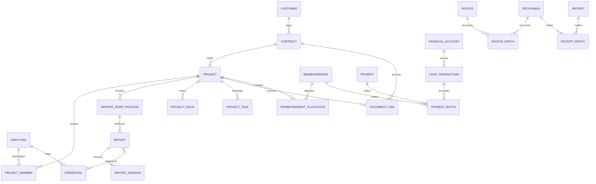

# 新 ERP 目标架构（提案）

> 版本：v0.1；状态：待业务流程核对。目标是重新设计系统，不是给旧系统换一套命名。以下为基于当前可见业务范围提出的初始模型，所有未确认业务规则均列为决策项。

## 1. 总体方案

采用**模块化单体（Modular Monolith）+ 清晰业务域 + 统一身份/文件/审计基础设施**作为第一阶段目标。

不预设微服务。一个可部署应用、一个主要关系数据库、明确模块边界和事务边界，能够先解决当前业务耦合与数据口径问题；将来只有当独立扩缩容、团队自治或部署隔离有明确收益时才拆分服务。

推荐逻辑分层：

1. Presentation：Web UI、移动端、公开报账入口、API。
2. Application：用例编排、事务边界、权限策略、跨域命令。
3. Domain：实体、值对象、状态机、业务规则。
4. Infrastructure：数据库、文件存储、消息/任务、外部集成。
5. Migration：独立旧系统读取、映射、预演、导入和核验工具，不依赖旧业务代码。

模块之间通过公开的应用服务/命令查询接口协作，不直接读写其他模块私有表。跨模块读模型可通过查询服务组合，避免为了“纯粹”而引入复杂消息系统。

## 2. 目标业务域

### A. 客户与商业关系
- 客户/委托单位、联系人、中间人/渠道关系。
- 客户与合同、项目之间的关系及历史名称快照。
- 中间人归属、佣金/结算规则只有在业务确认后才进入模型。

### B. 合同与商务
- 统一合同主体，类型作为分类或扩展信息，不再默认五类表复制共同字段。
- 合同编号、签署日期、履约期限、金额、付款/结算约定、归属、附件、版本和生命周期。
- 合同变更、补充协议、续签/终止作为独立关联记录，保留原合同历史。
- 合同状态与项目状态、开票状态、收款状态分开。

### C. 项目交付
- 项目是实际履约工作的聚合中心。
- 项目关联合同（目标暂按一个项目可关联一个主合同设计；一合同多项目允许；如业务证实一个项目需多合同，再采用关联表）。
- 项目基础资料、地址、委托方、负责人、技术负责人、起止日期、编号、状态。
- 项目子域：现场工作、任务/计划、问题整改、项目成员、项目文件、交付物。
- 项目完成不自动代表合同结算或财务结清。

### D. 技术服务与报告
- 将检测、评定、评估、维护保养等视为项目上的服务类型/工作包，而不是每个类型复制一套全新项目主数据。
- 每类服务有自己的业务记录、检查项、执行过程、报告模板和交付物。
- 报告是正式业务记录，保存生成时的项目、人员、资质、模板版本和关键数据快照；后续修改主档不能静默改写已签发报告。
- 报告草稿、预览、正式签发/归档明确区分；更正/替代保留版本链。

### E. 人员与组织
- 员工档案独立于登录账号。
- 员工、外部人员、联系人、系统用户是不同主体类型；必要时通过身份关联表建立映射。
- 角色（项目负责人、技术负责人、检测员、审核人、批准人、报账人）是业务任职/参与关系，不以某个用户 ID 字段兼任。
- 资质证书作为人员/组织的有期限资源，包含签发机构、有效期、附件和状态；报告引用资质快照。

### F. 财务与结算
至少区分以下业务对象：
- 费用/报账申请：员工申报、凭证、项目分摊、审批状态。
- 应收/收款：合同或项目应收计划、收款登记、到账账户和核销关系。
- 应付/付款：经核准的付款义务、付款登记、账户流水和核销关系。
- 资金账户：期初余额 + 已入账交易计算余额。
- 发票：开具/收到的发票事实，方向、购销双方、金额、税额、状态、附件。
- 银行/现金交易：收入、支出、内部转账、退款/冲正，均有账户和凭证。
- 对账：合同、项目、发票、应收应付和真实资金流水之间的核销/匹配关系。

当前系统已具备报账、资金账户、现金流水和开票登记的部分能力；是否需要完整应收应付子账、付款计划、银行导入，需业务确认后分阶段建设。严禁把“报账申请金额”直接计入现金支出，或把“开票金额”直接计入已收款。

### G. 文档与档案
- 文档元数据、文件二进制对象、业务归属、文档版本和访问权限分离。
- 同一文件可以被多个业务记录引用，但原件只有一个受控存储对象；删除一个引用不删除原件。
- 业务档案区分草稿、正式交付、历史快照、外部上传凭证。
- 文件引用需有明确业务主体和权限校验，避免仅凭 URL 暴露文件。

### H. 工作流与任务
- 将“待补资料、待复检、待审核、待支付、待对账”等待办由业务状态推导或由明确任务实体产生。
- 任务有负责人、期限、来源业务对象、状态和操作链接。
- 不把所有业务状态复制成一个万能 status 字段；任务中心是跨域工作视图，不成为新的事实来源。

### I. 平台基础
- 身份认证、RBAC/权限策略、组织范围、审计日志、通知、文件存储、编号服务、导入导出、系统配置。
- 授权在服务端执行；UI 可按权限优化可见性，但不能作为安全控制。
- 金额使用定点十进制；时间与时区统一；关键写操作支持幂等与并发控制。

## 3. 初始核心关系



这是目标关系草图，不是最终 DDL。尤其 CUSTOMER、应收/应付、收款核销和报账分摊是否需要独立实体，要通过真实业务流程和旧数据验证。

## 4. 状态模型原则

不同对象独立生命周期：
- 合同：草拟 → 待签署 → 生效 → 履约中 → 已完成/已终止；变更与补充协议独立留痕。
- 项目：待立项/待确认 → 准备中 → 执行中 → 待验收/待交付 → 已完成/已暂停/已取消。
- 服务工作包：待安排 → 执行中 → 待审核 → 已完成；异常可退回整改。
- 报告：草稿 → 待审核 → 已批准/已签发 → 已更正/已替代/已撤销；正式版本不可静默覆盖。
- 报账：草稿/已提交 → 审核中 → 已批准/已退回/已拒绝 → 部分支付/已支付。
- 发票：草拟/已开具/已收到 → 部分核销/已核销 → 已作废/已红冲。
- 资金交易：待入账/已入账 → 已冲正/已作废（保留原交易）。
- 项目归档、合同结算、财务结清是独立状态。

上面是候选状态，不得在未核实业务后直接实现；尤其审批角色、是否需要草稿、红冲/冲正法律与会计口径均待确认。

## 5. 核心业务约束

1. 项目不应复制合同金额、客户和付款事实；需要展示时通过关联读取，并对历史快照明确用途。
2. 员工档案不等于系统账号；操作人必须使用认证主体，业务参与人使用员工/外部人员主体。
3. 报账申请不等于现金付款；付款交易与申请之间通过核销/支付关系连接。
4. 发票不等于收款；开票、到账、核销分别建模。
5. 账户余额由期初余额和有效资金交易计算或由可重建账本投影得出，不允许多个页面各自维护余额。
6. 正式报告必须保存签发时数据、模板、人员与资质快照。
7. 删除业务关联不等于删除文件原件；所有重要业务记录保留审计轨迹。
8. 未确认的历史关联保持待确认，不按名称相似度自动合并。
9. 跨模块写操作由应用层事务编排，并验证所有关联对象的权限和状态。
10. 所有关键金额使用 DECIMAL/BigDecimal，接口以十进制字符串传输。

## 6. 建议的实现模块边界

```
platform/
  identity-access/
  audit/
  files/
  numbering/
  notifications/
business/
  crm/
  contracts/
  projects/
  workforce/
  service-delivery/
  reports/
  finance/
  workflow/
migration/
  legacy-discovery/
  mapping/
  dry-run/
  import/
  reconciliation/
```

这只是逻辑边界，最终目录和技术选型需在代码审计后确定。初期不拆成多个独立部署服务。

## 7. 需要业务确认的决策

- 客户是否需要独立主档？合同签约主体是否总是客户/委托单位？
- 一个合同可否对应多个项目？一个项目可否关联多个合同或补充协议？
- 合同金额是含税/未税？付款计划是否有正式业务约束？
- 是否存在真实的应收、收款登记和收款核销流程？
- 报账能否跨项目分摊？是否有审批、部分付款、借款/预支、退款？
- 发票是否同时管理销项和进项？红字发票如何记录？
- 项目、服务工作包、报告的签发/更正/作废角色分别是什么？
- 员工之外是否需要供应商、外包人员、客户联系人等主体？
- 哪些业务记录必须永久留存，哪些允许归档/匿名化？
- 是否需要项目成本分类、预算和利润分析？

## 8. 设计验收

目标模型必须能够解释并覆盖所有已确认业务场景；所有旧数据都能映射到新模型或进入明确的待确认队列；跨模块关系可追溯；金额和状态口径唯一；无需依赖旧系统的业务代码才能完成迁移。