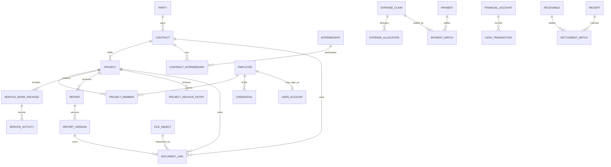

# 新 ERP 核心数据模型 v0.1

> 基于 2026-11-21 生产快照和代码审计形成的目标模型草案。它是设计提案，不是已冻结 DDL。旧表结构不构成目标约束；但源记录必须可追溯、可完整迁移。

## 1. 设计结论（由真实数据支持）

1. **合同应先合并为一个核心实体。** 五类合同扩展表的 19 个字段完全一致，identity 表另存类型。目标模型可将公共字段和类型直接合并为 `contract`，不再保留五张内容相同的类型表。未来若出现真实类型专属字段，再增加受约束的扩展表，而不是先创建空泛 JSON 字段。
2. **项目必须允许缺少合同、编号和人员。** 快照中 523/536 项目无合同，297/536 项目编号待确认，负责人和技术负责人字段各只有 13/536 非空，其中 11 个项目两者都有、4 个项目只填了其中一项、521 个项目两者都为空。目标模型需允许人员关系缺失并提供后续补齐。新模型必须支持待补齐数据，不得用强制必填或假值阻断迁移。
3. **报告编号不是主键，也不能直接加唯一约束。** 14 组重复、6 条空编号。内部主键独立，旧编号保留为业务标识；新发报告的唯一范围需业务定义。
4. **报告元数据、项目档案和文件原件是不同对象。** 352 条旧报告产生 497 条项目档案（报告/附件）；文件元数据有 2,193 条但无附件二进制。新模型必须分开 Report、ArchiveEntry、FileObject 和 FileLink。
5. **财务申请与现金事实分离。** 快照有 2 条报账，但账户、流水、发票均为空。保留申请和旧费用来源，不补造付款、账户余额或发票。
6. **人员档案与登录账号分离。** 19 员工、18 账号，17 个员工带旧账号来源；员工角色/资质不能由账号权限替代。
7. **旧来源映射是一等基础设施。** 项目、合同、报告、文件引用都存在历史 ID、编号别名或跨域匹配。所有迁移对象必须可由来源系统/表/主键定位。

## 2. 目标模块与权威数据

### 2.1 CRM / Parties
- `party`：客户、委托单位、供应商或其他组织主体。
- `person_contact`：联系人；可关联 party。
- `intermediary`：中间人/渠道主体。
- `party_relationship`：客户、联系人、中间人之间的角色关系。

是否需要供应商和多种主体类型，按后续真实流程确认。不要把联系人、员工、系统账号混成一个 user 表。

### 2.2 Contracts
建议核心实体：

| 实体 | 主要字段/含义 |
|---|---|
| contract | id、contract_no、type、name、party_id（可空）、manager/owner、start_date、end_date、amount DECIMAL、ownership_status、classification_status、remark、created_at、updated_at、version |
| contract_payment_term | contract_id、sequence、due_condition、planned_amount、due_date、remark |
| contract_intermediary | contract_id、intermediary_id、relationship_role、share/commission（只有业务确认后启用） |
| contract_revision | contract_id、revision_no、change_type、effective_date、snapshot、created_by |
| contract_document | contract_id、file_id、document_role、version、created_at |

付款计划若旧数据只是自由文本，应先保留原始 `payment_plan` 文本；不能未经核验就解析成确定的分期应收。合同金额和付款条款使用 DECIMAL，不使用浮点数。

### 2.3 Projects
| 实体 | 主要字段/含义 |
|---|---|
| project | id、project_no（可空/待确认）、type、name、contract_id（可空）、client_party_id（可空）、site_address、contact_id、leader_employee_id（可空）、technical_employee_id（可空）、start/end、status、remark、version |
| project_identifier | project_id、identifier、identifier_type（正式编号/历史编号/外部编号）、source、is_primary、valid_from/to |
| project_member | project_id、employee_id/person_id、role、start/end、source |
| project_issue | project_id、title、description、status、assignee、due_date |
| project_task/plan | project_id、title、owner、schedule、status |
| project_archive_entry | project_id、entry_type（报告/附件/交付物/其他）、title、source_report_id、created_at、legacy_snapshot |

编号不放在单个唯一字符串字段中：当前项目可有正式编号和多个历史别名。编号生成序列独立于历史编号。待编号项目必须可查询、可补号，且不得自动覆盖旧编号。

项目和合同：当前数据只显示 13 个项目有关联合同，绝大多数项目无合同。目标模型应允许 project.contract_id 为空。一个合同可否对应多个项目暂按允许；一个项目是否允许多个合同需业务确认，确认前不增加复杂多对多写入流程。

### 2.4 Workforce / Identity
| 实体 | 主要字段/含义 |
|---|---|
| employee | id、name、employee_type（可待确认）、active、remark、version |
| user_account | id、login_name、credential_hash、status、last_login |
| employee_account_link | employee_id、user_account_id、source_system、link_type |
| credential | id、holder_type、holder_id、kind、title、certificate_no、valid_from/to、status、file links |
| project_member | 项目参与身份，与登录账号无关 |

迁移时保留 17 个明确旧账号映射；其余员工不通过姓名相似度自动匹配。新系统账号是否保留旧密码散列须单独做安全兼容审查；默认要求安全重置，不在迁移报告中暴露任何密码字段。当前新资质表为空，不得伪造证书。

### 2.5 Service Delivery / Reports
| 实体 | 主要字段/含义 |
|---|---|
| service_work_package | project_id、service_type、scope、status、owner、scheduled_at、completed_at |
| service_activity | work_package_id、activity_type、occurred_at、participants、payload_snapshot |
| report | project_id、work_package_id（可空）、report_no（历史可重复）、report_type、status、issued_at、current_version_id |
| report_version | report_id、version_no、template_version_id、content_snapshot、project_snapshot、staff_snapshot、credential_snapshot、created_at、approved_at、issued_at |
| report_archive_link | report_version_id、file_id、document_role |

历史 352 条 `zj_report` 元数据与 497 条 `zj_project_document` 档案必须分别映射；报告编号不唯一，源主键是迁移幂等键。历史报告文件字段为空不等于没有项目档案引用，需同时检查 sys_file 和 project_document。

报告正式版本不可被当前项目/员工/资质信息静默改写。报告更正/替代建立新版本并保留旧版本。服务工作包和报告的基数（一个工作包多报告、一个报告覆盖多个工作包）待按真实业务确认。

### 2.6 Finance
| 实体 | 主要字段/含义 |
|---|---|
| expense_claim | 报账申请、申报人、代录人、金额、用途、项目分摊、凭证、审批状态 |
| expense_allocation | claim_id、project_id、amount；仅在确认允许跨项目分摊后启用 |
| payable | 经批准形成的付款义务 |
| payment | 真实付款事实、账户、日期、金额、交易凭证 |
| payment_match | payment 与 payable/claim 的核销关系，支持部分付款 |
| financial_account | 账户主体、币种、期初余额、启用状态 |
| cash_transaction | 入账资金事实：收入/支出/转账/冲正 |
| invoice | 销项/进项发票事实，金额、税额、方向、开具/收到状态 |
| receivable / receipt | 应收约定与实际到账事实 |
| settlement_match | 应收/应付、发票、到账和支付之间的核销关系 |

禁止把报账批准等同于付款、发票等同于收款、项目完成等同于结清。当前快照没有 account/transaction/invoice 行，目标库初始这些实体应为空。两条报账和一条旧费用记录保留原状态和来源，不创建伪造付款。

### 2.7 Documents
| 实体 | 主要字段/含义 |
|---|---|
| file_object | id、storage_key、original_name、mime_type、size、sha256、storage_status |
| document_link | file_id、owner_type、owner_id、role、version、created_by、created_at |
| document_version | logical_document_id、file_id、version_no、created_at、supersedes_id |

同一个文件可以关联合同、报告、项目档案等多个业务对象；二进制只存一份，业务关系单独维护。多态 owner 关系需要服务层强校验、周期性完整性扫描和下载授权检查。孤立文件引用保留为待确认，不自动删除。附件原件缺失时 storage_status 明确为 missing/unverified。

### 2.8 Workflow / Platform
- `task`：待办、负责人、截止时间、来源业务对象和状态；任务中心不成为业务状态事实源。
- `audit_event`：操作者、动作、目标对象、时间、请求 ID、差异摘要。
- `legacy_identity_map`：source_system、source_table、source_pk、target_type、target_id、mapping_version、batch_id、status。
- `migration_batch`、`migration_step`、`migration_exception`、`migration_reconciliation`：迁移运行、断点、异常与验收记录。
- `number_sequence`：按编号类别/年份独立维护，导入前校验最大已用编号。

## 3. 核心关系图（概念模型）

图为逻辑关系草图；实际文档关联可由 DocumentLink 统一表达，也可以在实现阶段对高价值业务使用显式连接表增强数据库外键约束。最终选择以完整性与维护成本评审为准。

## 4. 关键字段与约束

- 所有主键使用稳定内部 ID；旧来源主键只放在 LegacyIdentityMap，不把旧 ID 强迫为新主键。
- 金额统一 DECIMAL(18,2) 或更高精度（按合同历史精度评估）；API 金额使用十进制字符串。
- 日期、时间戳、时区分开；存储 UTC instant，业务日期使用 LocalDate，不把 UTC 转换造成的日期偏移写回。
- 历史编号允许重复/为空；新编号唯一约束只对新系统编号规则生效。
- 待确认状态显式建模；unknown 不等于 pending，也不等于 zero。
- 状态转换通过应用用例执行；禁止通用 CRUD 任意修改已签发/已入账状态。
- 软删除仅用于允许删除的对象；合同、报告版本、资金交易、审计与来源映射采用保留/作废/冲正，不物理删除。
- 幂等键按 source key + migration batch；重复导入不会重复创建目标记录。

## 5. 迁移顺序与依赖

1. Platform：目标 schema、用户/角色基线、文件对象存储配置、LegacyIdentityMap。
2. Parties/Intermediary/Employee：先建立主体与旧 ID 映射。
3. Contracts：合同主体、类型、付款文本、归属、附件引用。
4. Projects：项目主档、编号/别名、负责人、合同关系和历史来源快照。
5. Reports/Archives：历史报告元数据、项目档案和报告附件引用。
6. Maintenance：维保卡、编号、成品资料、项目资源关系。
7. Finance：费用申请/旧费用快照；空的账户/流水/发票保持空。
8. Documents：独立复制文件原件、计算 hash、回填文件对象状态和多业务引用。
9. Audit/Workflow：按保留策略迁移日志与有效待办。
10. Reconciliation：行数、金额、引用、文件 hash、报告版本和业务抽样验收。

## 6. 冻结前必须回答的业务问题

- 客户/委托单位是否需要独立主档，合同客户与项目客户是否总是一致？
- 一个项目能否有多个合同/补充协议？一个合同能否跨多个项目？
- 合同付款计划是自由文本还是可核销的正式应收义务？
- 旧报告编号重复是多版本、重复录入还是编号复用？新报告编号唯一范围如何定义？
- 员工类型“待确认”如何补齐；外部人员是否进入人员模块？
- 历史资质如何证明，哪些资质快照是报告签发的必要证据？
- 报账审批角色、部分支付、跨项目分摊、退款/冲正的规则是什么？
- 维保卡重复编号的两条记录是否历史重发、误录或不同业务范围？
- 附件缺失时是否允许迁移记录并标记 missing，哪些业务必须补齐文件才能切换？

## 7. 冻结门槛

此模型在以下事项完成前保持 v0.x：
- 旧字段逐列映射和类型/长度/精度校验；
- JSON/快照字段 schema 与真实值分布分析；
- 重复报告号、重复维保卡号和孤立文件引用人工确认；
- 文件存储原件盘点与 hash 验证；
- 关键业务状态与用户旅程确认；
- 完整 dry-run 结果和财务/档案抽样签字验收。